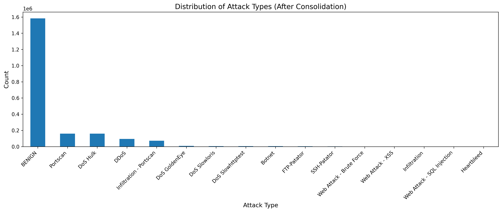
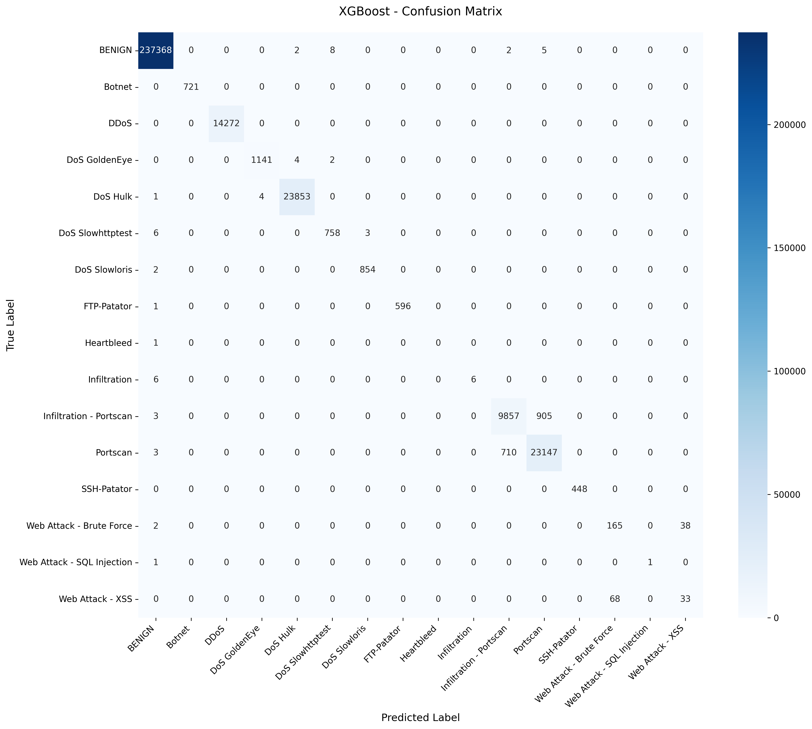
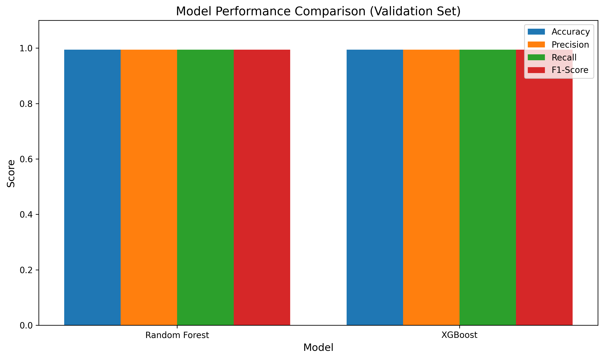
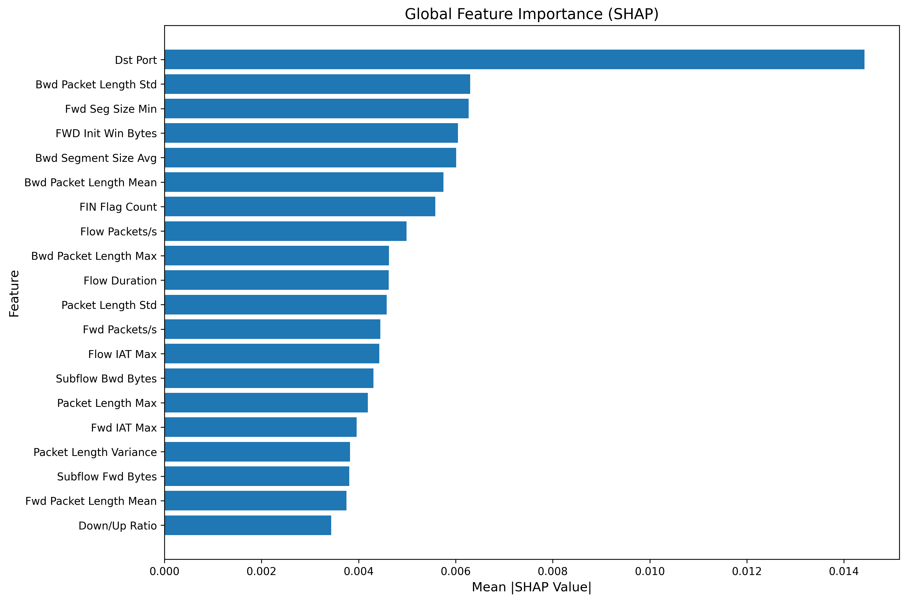

# A Machine Learning Based Approach Towards Building a Real-Time Network Intrusion Detection System

**Author:** Folosiye Adegbola
**Supervisor:** Omer Ali
**Institution:** South East Technological University
**Programme:** BSc (Hons) Software Development
**Academic Year:** 2025/2026

---

## Abstract

The increasing connectivity of network-dependent devices has expanded the attack surface of modern infrastructure beyond the capacity of traditional signature-based defences. This project presents a machine-learning-based Network Intrusion Detection System (NIDS) that classifies live network traffic flows into fifteen distinct attack categories and benign traffic, using a soft-voting ensemble of a Random Forest and an XGBoost classifier trained on the CIC-IDS2017 dataset. Feature selection via ANOVA F-test reduces the 84-feature input space to the 50 most discriminative features, and SMOTE is applied exclusively to the training set to address severe class imbalance. The ensemble achieves 99.44% accuracy and a macro-averaged F1 score of 0.87 on a held-out test set of 314,997 flows, with an overall accuracy of 93.5% (±1.0%) under randomised balanced-sample evaluation across all sixteen classes, and 95.0% on an end-to-end attack-reinjection test covering every attack category in the dataset. Batch-prediction throughput reaches 219 flows per second at a batch size of 500, a 98.3× per-flow speed-up over sequential calls. Every prediction is accompanied by a top-five SHAP attribution identifying the features most responsible for the classification decision, addressing the explainability gap that limits the adoption of ML-based security tools. The classifier is deployed as a FastAPI REST service behind rate limiting and optional API-key authentication, exposed to Prometheus metrics, and visualised in a pre-built Grafana dashboard. A real-time packet-capture engine built on Scapy demonstrates the full detection pipeline — from raw traffic on a live network interface to a classified alert — and is designed as the production-integration layer that an organisation would retrain on their own captured traffic before deployment.

---

## Acknowledgements

I would like to express my sincere gratitude to my supervisor, Omer Ali, for his guidance, patience, and consistent support throughout this project. I would also like to thank the faculty and staff of South East Technological University for providing the academic environment in which this work was completed. Finally, I acknowledge the Canadian Institute for Cybersecurity for making the CIC-IDS2017 dataset publicly available, without which the empirical foundation of this project would not have been possible.

---

## Table of Contents

1. Introduction
2. Literature Review
3. System Design and Architecture
4. Implementation
5. Evaluation and Results
6. Discussion
7. Project Management and Reflection
8. Conclusion
9. References
10. Appendices
    - Appendix A: Installation and User Guide
    - Appendix B: CIC-IDS2017 Feature List
    - Appendix C: Repository Structure
    - Appendix D: Example API Requests and Responses

---

## 1. Introduction

### 1.1 Background and Motivation

The proliferation of internet-connected devices — spanning mobile phones, cloud services, industrial control systems, and Internet of Things (IoT) appliances — has fundamentally altered the threat landscape of modern networks. As critical services migrate to networked infrastructure, the consequences of successful intrusion grow more severe. Network attacks now threaten not only data confidentiality but operational continuity, financial systems, and increasingly, physical safety in the case of industrial and medical networks (Buczak and Guven, 2016).

The primary technical response to this threat has historically been the Intrusion Detection System (IDS), a monitoring tool that inspects network traffic and raises alerts when suspicious behaviour is detected. The dominant class of IDS in operational deployment remains signature-based: the system maintains a database of known attack patterns and flags traffic that matches one of them (Lippmann et al., 2000). Signature-based systems offer low false-positive rates against known attacks and are computationally efficient, but they are fundamentally unable to detect novel attack variants that do not match an existing signature. Given that the threat landscape evolves continuously — with new zero-day exploits and polymorphic attack tools emerging regularly — this is a critical limitation.

Anomaly-based and machine-learning-based intrusion detection has been an active research area for more than two decades as a response to this gap. Instead of matching patterns, a machine-learning NIDS learns a statistical model of network behaviour from labelled historical traffic, then classifies new flows by comparing them against that model. Anomalous traffic — traffic that deviates statistically from the learned distribution of known-benign flows, or that resembles known-malicious flow patterns — is flagged regardless of whether it matches a specific signature (Sommer and Paxson, 2010).

This project builds a complete, operational machine-learning NIDS. It does not limit itself to demonstrating a trained classifier; it delivers a deployed, monitored, explainable system with a live packet-capture pipeline, a REST API, alerting, and containerised infrastructure — the components an organisation would need to move a research-grade classifier into a production environment.

### 1.2 Problem Statement

Signature-based intrusion detection fails on attacks it has not seen before. Machine-learning-based detection addresses this gap but introduces its own challenges: models trained on benchmark datasets may not generalise to real deployment environments; prediction results are often opaque; and the infrastructure required to apply a model to live traffic is rarely discussed in academic literature. This project addresses all three of these challenges:

1. **Generalisation:** The model is trained on CIC-IDS2017, a publicly available benchmark dataset representing realistic attack scenarios, and is evaluated on a held-out test set with balanced-class sampling to produce statistically robust accuracy estimates.
2. **Explainability:** Every prediction is accompanied by SHAP-based feature attributions so that a human operator can understand and audit the model's reasoning.
3. **Deployability:** The model is wrapped in production-grade infrastructure — a REST API, monitoring, alerting, containerisation — and the live-traffic pipeline is demonstrated end-to-end.

### 1.3 Aims and Objectives

The primary aim of this project is to design, implement, and evaluate a machine-learning-based Network Intrusion Detection System capable of classifying live network flows in real time with measurable accuracy and per-prediction explainability.

The objectives supporting this aim are:

- To conduct a literature review of existing NIDS approaches and ML-based intrusion detection methods, identifying the limitations of existing work and the justification for the chosen approach.
- To select an appropriate public dataset for training and evaluation, and to perform thorough data preprocessing and exploratory analysis.
- To train and evaluate a multi-class classification ensemble, using rigorous splitting and class-imbalance mitigation to produce reliable performance estimates.
- To wrap the trained model in a REST API with health monitoring, rate limiting, authentication, Prometheus metrics, and SHAP-based explanations.
- To implement a real-time packet-capture engine that demonstrates the full detection pipeline from wire to classified alert.
- To provide operational tooling — a live monitoring dashboard, Grafana visualisations, email and Slack alerting — sufficient for a deploying organisation to operate the system.

### 1.4 Scope

This project covers the training, evaluation, and operational deployment of a multi-class ML classifier for network intrusion detection. It does not implement a prevention system — detected attacks result in alerts and logs, not in automated blocking of traffic. The live-traffic engine is demonstrated on a single host and is not evaluated in a controlled multi-host network environment; that environment would be required for a production validation study, which is beyond the scope of a final year project. The model is evaluated on CIC-IDS2017 flows; performance on other datasets or real enterprise traffic may differ and would require retraining, as discussed in the production-integration section.

### 1.5 Report Structure

Chapter 2 reviews the relevant literature on intrusion detection, machine learning in network security, and explainability. Chapter 3 presents the system architecture and key design decisions. Chapter 4 describes the implementation of each component. Chapter 5 reports evaluation results and performance benchmarks. Chapter 6 discusses the results in context, including limitations and future directions. Chapter 7 reflects on the project management, ethical considerations, and challenges encountered during development. Chapter 8 concludes the report. Appendices at the end of the report provide installation and usage instructions, the full CIC-IDS2017 feature vocabulary, the repository layout, and example API request and response payloads.

---

## 2. Literature Review

### 2.1 Network Intrusion Detection: Overview and Taxonomy

An Intrusion Detection System monitors network or host activity and generates alerts when it identifies behaviour indicative of a security breach or policy violation. The canonical taxonomy, first systematised by Axelsson (2000), divides IDS into two broad categories: **signature-based** (or misuse-based) systems and **anomaly-based** systems.

Signature-based systems maintain a database of known attack patterns and alert when incoming traffic matches one of them. Products such as Snort (Roesch, 1999) and Suricata operate on this principle. Their advantage is precision against known attacks with low false-positive rates; their critical limitation is an inability to detect novel attacks for which no signature exists. The signature database must be continuously updated by human analysts, creating an inherent lag between the emergence of a new attack technique and the deployment of a detection rule.

Anomaly-based systems attempt to characterise normal network behaviour and flag traffic that deviates significantly from that baseline. The approach holds the theoretical promise of detecting novel attacks without prior knowledge of the attack's structure. Early work by Denning (1987) proposed statistical profiles of user and system behaviour as the anomaly baseline. The practical challenge, documented extensively in the literature, is that real network traffic is highly variable and that the boundary between anomalous and malicious is difficult to draw without generating excessive false positives (Sommer and Paxson, 2010).

Machine learning offers a middle path: rather than hand-crafting either attack signatures or anomaly thresholds, a model learns the statistical boundary between classes from labelled examples. The resulting classifier can generalise to attacks that share statistical properties with training examples even if the exact attack instance was not seen during training.

### 2.2 Machine Learning Approaches to NIDS

The application of machine learning to intrusion detection has been studied for over two decades. Stolfo et al. (2000) applied data mining techniques to the KDD Cup 1999 dataset and demonstrated that learned classifiers could achieve high detection rates. The KDD Cup 1999 dataset itself was subsequently criticised by Tavallaee et al. (2009), who showed that it contained a large proportion of duplicate records and that many high-detection-rate results in the literature were artefacts of this duplication rather than evidence of genuine generalisation.

The choice between binary classification (benign vs. attack) and multi-class classification (individual attack category identification) has been debated extensively. Yin et al. (2017) argue that multi-class classification is more operationally useful, as it provides actionable intelligence — knowing that a detected anomaly is specifically a DDoS attack rather than a generic anomaly allows security teams to respond appropriately. The present project takes this position and formulates the problem as a sixteen-class classification task.

Tree-based ensemble methods have consistently demonstrated strong performance on tabular network-flow data. Random Forest, introduced by Breiman (2001), combines the predictions of many decision trees trained on bootstrapped samples of the data, reducing variance through aggregation. Breiman's original work demonstrated superior generalisation compared to single decision trees and robustness to feature noise. Multiple studies have applied Random Forest to network intrusion detection and found it to perform competitively with more complex methods (Amin et al., 2021).

Gradient boosting, formalised by Friedman (2001), takes a complementary approach: rather than building trees in parallel and averaging them, it builds trees sequentially, each tree correcting the residual error of its predecessors. XGBoost (Chen and Guestrin, 2016) is a highly optimised implementation of gradient boosting that includes regularisation, column and row subsampling, and early stopping against a validation loss, all of which reduce overfitting. XGBoost has achieved state-of-the-art results across a wide range of tabular classification benchmarks and has been applied successfully to intrusion detection tasks (Zhang et al., 2022).

Deep learning approaches — particularly recurrent neural networks (RNNs) and long short-term memory (LSTM) networks — have been proposed for NIDS on the grounds that they can learn temporal dependencies between packets in a flow (Yin et al., 2017). While these methods report strong accuracy on standard benchmarks, Sommer and Paxson (2010) raise fundamental concerns about the applicability of deep learning to network security: the high dimensionality of the problem makes it difficult to distinguish malicious from legitimate anomalies, and the opacity of deep models makes it difficult for human operators to trust or audit the results. The present project deliberately chooses interpretable tree-based methods over neural architectures, partly for the performance characteristics of tree ensembles on structured tabular data and partly because tree-based models admit exact Shapley value computation via the SHAP framework.

### 2.3 The CIC-IDS2017 Dataset

The CIC-IDS2017 dataset (Sharafaldin, Habibi Lashkari and Ghorbani, 2018) is produced by the Canadian Institute for Cybersecurity and has become one of the most widely used benchmarks for intrusion detection research. It was created by simulating realistic user behaviour and executing a comprehensive set of attack scenarios across five days in a controlled testbed, capturing all traffic as raw PCAP files, and processing the captures through the CICFlowMeter tool to produce a flow-level CSV dataset with 84 statistical features per flow.

The dataset covers the following attack types: Brute Force via FTP and SSH (FTP-Patator, SSH-Patator), Denial of Service via multiple vectors (Slowloris, Slowhttptest, Hulk, GoldenEye), Distributed Denial of Service, Heartbleed, Web Attacks including Brute Force, Cross-Site Scripting, and SQL Injection, network Infiltration, and Botnet activity along with Port Scan. Benign background traffic represents typical corporate internet usage. In total the dataset contains approximately 2.83 million flow records across its CSV files, reducing to 2.1 million after deduplication and cleaning.

A significant characteristic of CIC-IDS2017 is its class imbalance. Benign traffic accounts for approximately 1.58 million flows (75% of the cleaned dataset), while some attack categories — notably Heartbleed (11 flows) and Web Attack SQL Injection (18 flows) — are extremely rare. This imbalance makes standard accuracy a poor evaluation metric and necessitates the use of resampling techniques and macro-averaged metrics that weight each class equally. The severity of the imbalance is visualised in Figure 1, which plots the per-class flow counts on a logarithmic axis after cleaning: Benign traffic exceeds the rarest class by more than five orders of magnitude.



*Figure 1 — Per-class flow counts in the cleaned CIC-IDS2017 dataset. Log scale on the x-axis; Benign highlighted in green, attack classes in blue.*

Engelen et al. (2021) performed a thorough analysis of CIC-IDS2017 and identified several concerns: some features exhibit near-infinite values that may indicate errors in the CICFlowMeter computation; some classes (particularly Infiltration) are highly ambiguous and difficult to separate from benign traffic; and the dataset's controlled-environment nature means that traffic patterns may not fully represent the diversity of real enterprise networks. These concerns are acknowledged as limitations of the present work.

### 2.4 Class Imbalance and Resampling

Class imbalance is a pervasive problem in intrusion detection, where benign traffic typically dominates by orders of magnitude. Training a classifier on imbalanced data without mitigation produces models that are biased towards the majority class: the model achieves high accuracy by predicting "benign" for everything while detecting few genuine attacks.

SMOTE (Synthetic Minority Over-sampling Technique), introduced by Chawla et al. (2002), addresses this by generating synthetic minority-class samples through interpolation in the feature space. For each minority-class sample, SMOTE selects k nearest neighbours and creates new samples by random linear interpolation between the sample and one of its neighbours. The approach is well-established in the imbalanced learning literature and has been applied widely in intrusion detection contexts (García et al., 2012). A critical implementation requirement is that SMOTE must be applied only to the training set; applying it to validation or test data would constitute data leakage, inflating evaluation metrics artificially.

### 2.5 Explainability in Machine Learning Security Systems

The deployment of machine learning models in security-critical settings introduces a governance challenge: human security analysts need to understand and trust the model's decisions before they can act on them. A model that generates an alert without any explanation of why the alert was raised is difficult to validate and may be disregarded or may generate alarm fatigue.

Shapley Additive exPlanations (SHAP), introduced by Lundberg and Lee (2017), provide a theoretically grounded framework for explaining individual predictions of any machine learning model. Based on Shapley values from cooperative game theory, SHAP assigns each feature a contribution score for a given prediction such that the contributions sum to the difference between the prediction and the average prediction across the dataset. For tree-based models, Lundberg et al. (2020) derived the TreeExplainer algorithm, which computes exact Shapley values in polynomial time — avoiding the sampling approximations required for other model types.

SHAP attributions have been adopted in a number of recent NIDS research papers as a method for increasing operator trust and enabling model auditing (Faker and Dogdu, 2019). The present project embeds SHAP explanation directly into the prediction API response, so that every classification decision returned to a client includes the top five contributing features and their signed attribution values, without requiring a separate post-hoc analysis step.

### 2.6 Summary and Justification of Approach

The literature establishes several clear conclusions that inform the design of this project. First, signature-based detection has fundamental limitations against novel attacks; ML-based detection is theoretically superior but requires careful evaluation methodology. Second, tree-based ensemble methods (Random Forest, XGBoost) are robust, well-studied, and well-suited to the structured tabular features of network flow data. Third, class imbalance must be addressed through principled resampling applied only to training data. Fourth, explainability is not optional in production security tooling. Fifth, operational deployment — not just classifier training — is the goal.

This project synthesises these lessons into a system that not only trains and evaluates a classifier but wraps it in the infrastructure required for actual deployment.

---

## 3. System Design and Architecture

### 3.1 Architectural Overview

The system is structured as two cleanly separated tiers communicating over HTTP, with supplementary monitoring and operational infrastructure. This decoupled design is a deliberate choice: the classification service can be evaluated, benchmarked, scaled, and updated independently of the packet-capture layer, and the two can be deployed to different hosts or containerisation environments.

**Tier 1 — Classification Service (`api/`):** A stateless FastAPI REST application that loads trained model artefacts at startup and exposes a prediction endpoint accepting 84-feature flow vectors. It handles preprocessing (scaling and feature selection), runs both trained classifiers, averages their probability distributions, computes SHAP attributions, and returns a structured JSON response.

**Tier 2 — Real-Time Engine (`src/`):** A Python process that captures raw IP packets from a network interface using Scapy, aggregates them into bidirectional 5-tuple flows, extracts the 84 CIC-IDS2017 features from each completed flow, and posts the feature vector to Tier 1 via HTTP. The engine supplements the ML classifier with two lightweight heuristic detectors — a SYN-flood detector and a port-scan detector — that operate on cross-flow aggregate statistics.

**Supporting infrastructure:** A Flask dashboard (`dashboard/`) streams detection events to a browser in real time via Server-Sent Events. Prometheus scrapes the classification service's `/metrics` endpoint every fifteen seconds and feeds time-series data to a pre-built Grafana dashboard. Email (SMTP) and Slack (webhook) alerting is handled by a configurable alert manager inside the engine. The full stack is containerised with Docker Compose for one-command deployment.

### 3.2 Decoupling Rationale

Decoupling the classification service from the packet-capture engine serves several purposes. The API can be developed, tested, and evaluated against known flows (from the CIC-IDS2017 dataset or the demonstration traffic simulator) independently of any live-traffic infrastructure. The engine can be replaced or modified — for instance, by substituting a different feature extractor — without touching the classification logic. In a production deployment the API could be placed on a dedicated host with GPU acceleration or multiple Uvicorn workers, while lightweight engines run on multiple network monitoring hosts throughout an organisation's infrastructure, all posting to the same central API. This is the architecture employed by production NIDS platforms such as Zeek (Paxson, 1999) combined with a centralised analysis pipeline.

### 3.3 Data Flow

Figure 2 summarises the two-tier architecture and the HTTP coupling point between them.


*Figure 2 — Placeholder: system architecture diagram. The deployed dashboard screenshot is included for reference; a dedicated architectural diagram is embedded in the showcase site (`site/index.html`) as inline SVG.*

The complete data flow for a single detection event is as follows:

1. A packet arrives at the monitored network interface. Scapy's `sniff()` function, configured with a kernel-level BPF filter of `"ip"`, passes the packet to a callback handler.
2. The callback extracts the relevant fields (source IP, destination IP, protocol, source and destination ports, payload length, TCP flags, timestamp) into a lightweight `CapturedPacket` dataclass and places it in a thread-safe queue.
3. The engine's main loop, ticking every 100 milliseconds, drains the packet queue and passes each packet to the flow aggregator.
4. The flow aggregator looks up the packet's 5-tuple in its active-flow table (checking both forward and reverse directions for bidirectionality). If no matching flow exists, a new `Flow` object is created. The packet is appended to the flow's forward or backward packet list.
5. A flow is marked complete when a TCP graceful close (both FIN flags) or reset (RST flag) is observed, when the flow reaches 1,000 packets, or when no new packet has arrived within 10 seconds (idle timeout). Timeout-based expiry is handled by a periodic cleanup sweep.
6. Completed flows are passed to the feature extractor, which computes the 84 CIC-IDS2017 statistical features and returns them as a dictionary.
7. The feature vector is submitted to a ThreadPoolExecutor of four workers. A worker posts it to the classification service's `/predict` endpoint via HTTP.
8. The classification service preprocesses the features (scaling → feature selection), runs both models, averages probabilities, computes SHAP attributions, and returns a JSON response containing the predicted class, confidence score, `is_attack` flag, and top-five SHAP features.
9. The engine's result handler checks whether `is_attack` is true and whether confidence exceeds the configured threshold (0.80 by default). If both conditions hold, the event is logged to the session's `attacks.log` file and submitted to the alert manager for dispatch to configured email and Slack channels.
10. Prometheus, on its 15-second scrape, collects updated counters and histogram observations. The Grafana dashboard and Flask monitoring UI reflect the new data.

### 3.4 Training Pipeline Design

The training pipeline is an offline sequence of scripts that processes the raw CIC-IDS2017 CSV files and produces six saved model artefacts. These artefacts are the only connection between the training environment and the runtime prediction service; the runtime service never touches the raw training data.

The key design constraint is **no leakage across the train/validation/test boundary.** The standard scaler is fitted exclusively on training data. Feature selection is performed on training data only. SMOTE is applied to training data only. Validation data is used solely for XGBoost's early stopping criterion. Test data is touched only for the final evaluation reported in this project; it is not used for any model selection or hyperparameter decision.

### 3.5 Technology Selection

**Python 3.11** was selected as the implementation language for its mature ecosystem of data science and network libraries, its performance improvements in the 3.11 release, and its suitability for rapid development of the mixed data-science and systems-programming workloads this project requires.

**scikit-learn** (Pedregosa et al., 2011) provides the Random Forest classifier, the StandardScaler, the SelectKBest feature selector, and SMOTE through the `imbalanced-learn` extension. scikit-learn's consistent API and integration with the broader Python ML ecosystem made it the natural choice for these components.

**XGBoost** (Chen and Guestrin, 2016) is used for its well-documented performance on tabular classification tasks and for its native support for early stopping, which simplifies hyperparameter selection for the number of boosting rounds.

**SHAP** (Lundberg and Lee, 2017) is used via its `TreeExplainer` implementation, which computes exact Shapley values for tree-based models efficiently. The TreeExplainer is the only SHAP explainer that avoids approximation, making it appropriate for a system where explanations are returned to users as part of the API response.

**FastAPI** (Ramírez, 2018) was selected for the REST API over Flask or Django because of its first-class support for async handlers, its automatic OpenAPI documentation generation, its Pydantic-based request validation, and its performance — Uvicorn/FastAPI has substantially lower latency than synchronous WSGI frameworks under concurrent load, which matters for a prediction service that may receive many simultaneous requests.

**Scapy** (Biondi, 2003) was selected for packet capture for its pure-Python implementation and its rich protocol support. Scapy's `sniff()` function with `store=False` ensures that packets are processed and discarded immediately, preventing memory growth during sustained captures.

**Docker Compose** is used for multi-service containerisation. A multi-stage Dockerfile minimises the production image size by separating build-time dependencies (compilation tools for certain native extensions) from the runtime image.

---

## 4. Implementation

### 4.1 Data Preprocessing

Raw CIC-IDS2017 CSV files contain one row per network flow with 84 numerical features and a categorical label. Preprocessing performs the following steps.

**Consolidation.** The seven day-split CSV files are merged into a single dataframe. Column names are standardised to the canonical 84-feature vocabulary defined in `src/constants.py` — the CICFlowMeter tool produces slightly inconsistent spacing and capitalisation across versions, and this normalisation ensures the downstream pipeline operates on a consistent schema.

**Cleaning.** Rows containing non-finite values (`NaN`, `Inf`, `-Inf`) are removed. These arise from CICFlowMeter's computation of rate features (bytes per second, packets per second) when flow duration is zero, which produces a division-by-zero. Approximately 2.7% of rows are removed in this step.

**Label standardisation.** The CIC-IDS2017 label vocabulary contains minor inconsistencies across the day-split files (trailing whitespace, differing capitalisation). Labels are normalised to a canonical set of sixteen classes. The full class list is: BENIGN, Botnet, DDoS, DoS GoldenEye, DoS Hulk, DoS Slowhttptest, DoS Slowloris, FTP-Patator, Heartbleed, Infiltration, Infiltration - Portscan, Portscan, SSH-Patator, Web Attack - Brute Force, Web Attack - SQL Injection, and Web Attack - XSS.

The cleaned dataset, saved to `data/processed/cicids2017_cleaned.csv`, contains 2,099,976 rows.

### 4.2 Feature Engineering and Selection

The 84 CIC-IDS2017 features span several statistical categories:

- **Basic identifiers:** Source port, destination port, protocol.
- **Packet counts and byte volumes:** Total forward and backward packet counts; total forward and backward byte volumes.
- **Packet-length distributions:** Minimum, maximum, mean, and standard deviation of payload lengths in forward and backward directions separately, and combined.
- **Inter-arrival times (IAT):** Mean, standard deviation, maximum, and minimum of the time between consecutive packets, computed for the forward direction, backward direction, and overall flow separately.
- **TCP flag counts:** Counts of SYN, FIN, RST, PSH, ACK, URG, CWR, and ECE flags in each direction.
- **Rate features:** Packets per second and bytes per second for each direction and combined.
- **Active and idle periods:** Statistics describing the durations of active subflows (periods of packet activity) and idle periods within a flow.
- **Window sizes and segment sizes:** Initial TCP window bytes in each direction; forward and backward segment size averages.
- **ICMP metadata:** ICMP code and type for ICMP flows.

**Scaling.** A `StandardScaler` is fitted on the training set and applied to all three splits. Standardisation transforms each feature to zero mean and unit variance, which is required for the internal distance calculations within SelectKBest and prevents features with large absolute magnitudes from dominating the feature importance signal during XGBoost's gradient computation.

**Feature selection.** `SelectKBest` with the ANOVA F-statistic selects the 50 most discriminative features. The ANOVA F-test measures the ratio of between-class variance to within-class variance for each feature; features with high F-statistics contribute more to separating the class distributions. Reducing from 84 to 50 features serves two purposes: it reduces prediction latency (fewer features means faster model inference) and removes features that add noise without discriminative power. The selector is fitted on the training set only and saved to `models/feature_selector.pkl`; at runtime, the API applies the saved selector to restore the exact 50-feature subset used during training. The list of selected features is stored in `data/processed/selected_features.txt` for transparency.

### 4.3 Class Imbalance Mitigation

SMOTE is applied to the scaled training set. The sampling strategy is configured to bring each minority class to at least a moderate representation relative to the majority class, with the number of synthetic neighbours (`k_neighbors`) adjusted per class based on available samples — classes with very few real samples (Heartbleed: 11, SQL Injection: 18 in the full dataset) are upsampled more conservatively to avoid generating unrealistic interpolations. SMOTE is not applied to the validation or test splits; these retain the original class distribution to provide an unbiased estimate of real-world performance.

### 4.4 Model Training

**Random Forest.** The RF classifier is configured with 200 estimators (trees), a maximum depth of 20, and a minimum of 5 samples required to split an internal node. These hyperparameters were selected based on standard guidance in the literature (Breiman, 2001) and preliminary experimentation on the validation set. The `random_state` is set to 42 for reproducibility. Training runs on 2 parallel jobs (`n_jobs=2`) to limit memory consumption to approximately 8 GB, which fits within the 16 GB RAM available on the development machine.

**XGBoost.** The XGBoost classifier is configured with a maximum of 300 boosting rounds, a maximum tree depth of 10, a learning rate of 0.1, and row and column subsampling rates of 0.8. Early stopping is configured with a patience of 10 rounds monitored against the multi-class log-loss on the validation set. In practice, early stopping terminates training well before 300 rounds on most runs, preventing overfitting without requiring a manual search over the number of rounds.

**Ensemble.** At prediction time, both models emit a 16-element probability distribution — one probability per class. The ensemble averages these two distributions to produce the final probability vector. The class with the highest averaged probability is reported as the prediction, and the averaged probability at that class index is reported as the confidence score. This soft-voting approach exploits the complementary strengths of the two models: Random Forest reduces variance through bagging and handles small classes robustly; XGBoost reduces bias through boosting and typically achieves stronger performance on well-represented classes.

### 4.5 Classification Service (API)

The API is a FastAPI application (`api/app.py`) that loads the six model artefacts — scaler, feature selector, label encoder, Random Forest, XGBoost, and training configuration — at startup via `joblib`. A startup-time integrity check verifies that all artefacts are present and that the label encoder covers the expected 16 classes, raising a startup error before the server begins accepting connections if any artefact is missing or malformed.

**Endpoints.** The `/predict` endpoint accepts a JSON payload containing a dictionary of feature name to float value pairs (the 84 CIC-IDS2017 feature names as keys). It is rate-limited to 60 requests per minute. The `/batch_predict` endpoint accepts a list of up to 1,000 such dictionaries and returns a list of predictions, enabling bulk ingestion without the overhead of 1,000 individual HTTP round-trips. The `/metrics` endpoint exposes Prometheus-compatible metrics in the standard exposition format. The `/health` endpoint returns model-load status and uptime. The `/docs` endpoint serves auto-generated Swagger UI documentation.

**Preprocessing.** Each prediction request undergoes the same three preprocessing steps in the same order as training: feature-vector assembly (projecting the input dictionary into the canonical 84-feature order defined in `src/constants.py`, with missing features defaulting to zero), StandardScaler transformation (using the saved, fitted scaler), and SelectKBest transformation (using the saved, fitted selector). Any deviation from this exact sequence would produce a distribution shift that causes the model to receive incorrectly scaled or incorrectly ordered feature values, resulting in degraded predictions.

**SHAP explanations.** A `TreeExplainer` is initialised on the XGBoost model at API startup. For each `/predict` call, SHAP values are computed for the single input sample. The top five features by absolute SHAP value are extracted and returned in the response alongside their signed attribution values, indicating not only which features drove the prediction but in which direction — a high positive SHAP value for `SYN Flag Count` indicates that an unusually high SYN flag count pushed the prediction towards an attack class.

**Authentication and rate limiting.** API-key authentication is enabled by setting the `NIDS_REQUIRE_AUTH` environment variable to `true`. Per-endpoint rate limits are configurable via environment variables, with defaults of 60 per minute for `/predict` and 30 per minute for `/batch_predict`. Rate limiting is implemented via the `slowapi` library, which uses token-bucket counters stored in memory.

### 4.6 Real-Time Engine

**Packet capture (`src/packet_capture.py`).** Scapy's `sniff()` is called with `store=False` and a BPF filter of `"ip"`. The `store=False` flag instructs Scapy to discard packets immediately after the callback returns, preventing memory accumulation. The BPF filter is installed at the kernel (or WinPcap/Npcap on Windows) layer, discarding non-IP frames before they reach Python. Each IP packet's relevant fields are extracted into a `CapturedPacket` dataclass and placed in a thread-safe queue.

**Flow aggregation (`src/flow_aggregator.py`).** The aggregator maintains a dictionary of `Flow` objects keyed by canonical 5-tuple. For each incoming packet it computes the forward key (`src_ip:src_port-dst_ip:dst_port-proto`) and the reverse key; if either matches an existing flow, the packet is appended to that flow with the appropriate direction bit. Separate lists maintain forward and backward packet objects for independent statistical computation. Flow completion follows three trigger conditions: TCP graceful close (both directions have emitted FIN), TCP abrupt close (any direction has emitted RST), and size or idle timeout (1,000 packets or 10 seconds of inactivity, the latter checked by a cleanup sweep every 5 seconds).

**Feature extraction (`src/feature_extractor.py`).** For each completed flow, the extractor iterates over the forward and backward packet lists and computes the 84 named statistics. Statistical aggregation helpers (`safe_mean`, `safe_std`, `safe_max`, `safe_min`) return zero for empty sequences to handle single-direction flows gracefully. The result is a Python dictionary mapping the 84 feature names to float values.

**Concurrency (`src/nids_engine.py`).** The engine's main loop runs on a single thread, ticking every 100 milliseconds. Each tick drains the packet queue, feeds packets to the aggregator, and collects completed flows for feature extraction. Feature extraction runs inline on the main thread (it is purely computational and fast). Prediction HTTP calls are submitted to a `ThreadPoolExecutor` of four workers, allowing up to four predictions to be in-flight simultaneously while the main loop continues processing new flows. This prevents the 10–100 millisecond HTTP round-trip from blocking flow processing under moderate traffic load.

**Heuristic detectors.** Two rule-based detectors supplement the ML classifier. The port-scan detector maintains a per-source-IP counter of distinct destination ports contacted within a rolling 30-second window; when a single source opens connections to 15 or more distinct ports within the window, a port-scan alert is raised. The SYN-flood detector counts SYN-only flows (flows where no ACK was observed) from each source within a 10-second window; 20 or more such flows triggers a flood alert. Both detectors fire independently of the ML classifier confidence threshold and log to the same `attacks.log` file with a `conf=RULE` marker to distinguish them from ML detections.

### 4.7 Monitoring and Operational Infrastructure

**Flask dashboard (`dashboard/app.py`).** A lightweight Flask application serves a single-page monitoring interface. Detection events are pushed to connected browsers via Server-Sent Events (SSE) — a unidirectional HTTP streaming mechanism that does not require WebSocket negotiation. Each event renders as a detection card showing the predicted class, confidence score, source and destination IP:port, and an expandable SHAP bar chart showing the top-five contributing features. The dashboard uses the Catppuccin Mocha dark colour scheme for readability in low-light environments. Figure 8 shows the dashboard during an attack replay.


*Figure 8 — Flask monitoring dashboard: live detection cards streamed over SSE, severity badges, expandable SHAP attributions, and session-level counters.*

**Prometheus and Grafana.** The API exposes six metrics: `nids_predictions_total` (counter, by predicted class), `nids_attacks_detected_total` (counter, by attack type), `nids_prediction_latency_seconds` (histogram, 14 buckets from 0.001s to 10s), `nids_batch_predictions_total` (counter), `nids_models_loaded` (gauge), and `nids_api_uptime_seconds` (gauge). Prometheus is configured to scrape the API every 15 seconds. A pre-built Grafana dashboard with 11 panels is provisioned automatically via Grafana's datasource and dashboard provisioning mechanism — no manual dashboard setup is required. Figure 6 shows a screenshot of the Grafana dashboard during a demonstration run; Figure 7 shows the Prometheus targets page confirming the API scrape is healthy.


*Figure 6 — Pre-built Grafana dashboard: attack-rate pie chart, latency percentiles, prediction-rate time series, per-class attack counters, API uptime, model status.*


*Figure 7 — Prometheus `/targets` page confirming the NIDS-API scrape job is healthy with the configured 15-second scrape interval.*

**Alerting (`src/alerting.py`).** Two alert channels are supported. Email alerts are sent via SMTP (compatible with Gmail, Outlook, and any SMTP server), with HTML-formatted bodies including attack type, severity, confidence, source and destination IPs, and the SHAP top-five attribution. Slack alerts are sent via incoming webhook with equivalent content. Both channels are configurable with minimum confidence thresholds and per-channel cooldown windows that suppress duplicate alerts during sustained attacks.

**Session logging.** Each engine run creates a timestamped directory under `logs/sessions/YYYYMMDD_HHMMSS/` containing four log files: `engine.log` (lifecycle and operational events), `predictions.log` (one entry per classified flow), `attacks.log` (one entry per raised alert), and `summary.log` (cumulative statistics at shutdown).

---

## 5. Evaluation and Results

### 5.1 Experimental Setup

The dataset is partitioned using a stratified 70/15/15 split: 70% of flows for training, 15% for validation (used only for XGBoost early stopping), and 15% for test evaluation. Stratification preserves the class distribution in each split, ensuring that rare classes such as Heartbleed and SQL Injection are represented in the test set even though they account for fewer than 20 flows in the full dataset.

All reported metrics use the held-out test set. The test set is touched only after all modelling decisions (feature selection, SMOTE parameters, hyperparameter choices) have been finalised — it is never used to influence any training or model-selection decision.

The primary evaluation metric is **macro-averaged F1 score**, which computes the F1 score for each class independently and averages them without weighting by class size. Macro F1 is preferred over accuracy or weighted F1 for this task because the class distribution is severely imbalanced; a degenerate classifier that predicts "BENIGN" for every flow would achieve approximately 75% accuracy but a macro F1 score near zero. Accuracy is reported alongside macro F1 for comparability with the literature.

### 5.2 Held-Out Test Set Results

Table 1 summarises overall performance on the 314,997-flow held-out test set.

**Table 1: Overall model performance on held-out test set**

| Metric | Random Forest | XGBoost |
|---|---|---|
| Accuracy | 99.40% | 99.44% |
| F1 (macro) | 0.8732 | 0.8337 |
| Precision (macro) | 0.8753 | 0.8780 |
| Recall (macro) | 0.8771 | 0.8123 |

Both models achieve accuracy above 99% on the held-out test set. The macro F1 gap between the two models (0.87 RF versus 0.83 XGBoost) reflects a difference in how the models handle the rarest classes: Random Forest achieves perfect precision and recall on Heartbleed (11 test samples), while XGBoost assigns zero probability to this class — a consequence of its gradient-boosting objective over-fitting to the dominant classes when faced with only 2–3 Heartbleed samples in the training set after the stratified split. XGBoost demonstrates stronger precision on SQL Injection (0.50 versus 0.00 for RF), a class where Random Forest similarly fails.

Figure 3 plots the XGBoost row-normalised confusion matrix on the held-out test set, which makes per-class performance visible despite the extreme imbalance in absolute counts. The leading diagonal is close to unity for thirteen of the sixteen classes; the three off-diagonal clusters that remain are concentrated on the Web-Attack family and on Heartbleed, both of which suffer from extreme data scarcity as discussed above.



*Figure 3 — XGBoost row-normalised confusion matrix on the 314,997-flow held-out test set. Cells show the proportion of each true class assigned to each predicted class; raw counts are annotated for reference.*

Figure 4 contrasts the per-class precision and recall of Random Forest and XGBoost side by side. Both models perform nearly identically on the twelve well-represented classes; they differ visibly on Heartbleed (RF perfect, XGBoost zero), on SQL Injection (the reverse), and on the Web-Attack family. These differences are the principal justification for using the two models as a soft-voting ensemble rather than picking a single winner.



*Figure 4 — Per-class precision and recall on the held-out test set. Generated by `generate_model_comparison.py` from the saved model artefacts.*

Table 2 presents the same per-class precision and recall as Figure 4, in numerical form.

**Table 2: Per-class precision and recall on held-out test set**

| Class | RF Prec. | RF Rec. | XGB Prec. | XGB Rec. |
|---|---|---|---|---|
| BENIGN | 1.000 | 1.000 | 1.000 | 1.000 |
| Botnet | 1.000 | 0.999 | 1.000 | 1.000 |
| DDoS | 1.000 | 1.000 | 1.000 | 1.000 |
| DoS GoldenEye | 0.994 | 0.995 | 0.991 | 0.997 |
| DoS Hulk | 1.000 | 1.000 | 1.000 | 0.999 |
| DoS Slowhttptest | 0.991 | 0.991 | 0.986 | 0.991 |
| DoS Slowloris | 0.995 | 0.996 | 0.995 | 0.996 |
| FTP-Patator | 1.000 | 1.000 | 1.000 | 1.000 |
| Heartbleed | 1.000 | 1.000 | 0.000 | 0.000 |
| Infiltration | 1.000 | 0.667 | 1.000 | 0.500 |
| Infiltration - Portscan | 0.917 | 0.928 | 0.913 | 0.931 |
| Portscan | 0.967 | 0.962 | 0.968 | 0.960 |
| SSH-Patator | 1.000 | 1.000 | 1.000 | 1.000 |
| Web Attack - Brute Force | 0.707 | 0.849 | 0.717 | 0.790 |
| Web Attack - SQL Injection | 0.000 | 0.000 | 0.500 | 0.500 |
| Web Attack - XSS | 0.500 | 0.287 | 0.494 | 0.396 |

Thirteen of the sixteen classes achieve precision and recall above 0.90 in at least one model. The three underperforming classes — Heartbleed, Web Attack SQL Injection, and Web Attack XSS — all correspond to classes with very few samples in the dataset. Heartbleed has 11 flows, SQL Injection has 18 flows, and XSS has 652 flows. The insufficient sample size means the models do not see enough genuine examples to learn the full diversity of the class, and the synthetic SMOTE samples may not adequately represent the decision boundary. This is a dataset limitation, not an architectural one: additional real examples of these attack classes would be expected to improve performance substantially.

The Infiltration class also shows reduced recall (0.67 for RF, 0.50 for XGBoost), despite adequate sample sizes. Engelen et al. (2021) note that Infiltration flows in CIC-IDS2017 are difficult to separate from benign traffic because the attack was conducted using a victim machine already inside the network, producing traffic patterns indistinguishable from normal user activity in many flows.

### 5.3 Randomised Balanced Evaluation

The held-out test set's class imbalance means that the headline accuracy figures are dominated by the well-represented classes. To produce a more balanced estimate of performance across all classes, a randomised evaluation protocol was employed: for each run, a small fixed number of test samples (20) are randomly drawn from each class and predictions are made; this is repeated across ten random seeds. The procedure is implemented in `randomised_evaluation.py` and produces both a CSV of per-run metrics and a human-readable summary. Table 3 summarises the results from the most recent run (10 April 2026).

**Table 3: Randomised balanced evaluation results (10 runs, 20 samples per class per run)**

| Metric | Value |
|---|---|
| Number of evaluation runs | 10 |
| Samples per class per run | 20 |
| Mean overall accuracy | 93.5% |
| Standard deviation | 1.0% |
| 95% Confidence Interval | [92.9%, 94.1%] |

The 93.5% balanced accuracy provides a more conservative and operationally realistic estimate of performance, accounting for the difficulty of the rarest classes. The narrow confidence interval (±1.0%) indicates stability across runs. Per-class mean accuracies reveal the same pattern observed in the held-out test evaluation: twelve of the sixteen classes achieve 100.0% mean accuracy across the ten runs; Heartbleed, Infiltration, Port Scan, and the three Web-Attack categories score between 66.5% (Web XSS) and 99.5% (DoS Slowhttptest). The dominant confusion patterns — Web XSS misclassified as Web Brute Force (64 occurrences across 200 test samples), SQL Injection and Heartbleed misclassified as BENIGN — reflect the scarcity of training examples for these classes rather than an architectural limitation of the classifier.

### 5.4 Feature Importance

The global SHAP analysis identifies `Dst Port` as the single most important feature, with a mean absolute SHAP value approximately twice that of the next most important feature. This finding is consistent with the literature: destination port is a strong discriminator between attack types because many attacks target specific well-known ports (e.g., DDoS and DoS attacks often target port 80/443; FTP-Patator targets port 21; SSH-Patator targets port 22). The next most important features include `Bwd Packet Length Std`, `Fwd Seg Size Min`, `FWD Init Win Bytes`, `Bwd Segment Size Avg`, and `FIN Flag Count` — a mix of packet-size distribution statistics and TCP connection-establishment indicators that together characterise the structural properties of different traffic classes. Figure 5 plots the full ranking of the top twenty features by mean absolute SHAP value.



*Figure 5 — Global feature importance for the XGBoost classifier, measured as the mean absolute SHAP value across the held-out test set. Destination port is the single strongest discriminator, followed by a cluster of packet-size and TCP-flag features.*

### 5.5 API Performance

The prediction API was benchmarked using the dedicated `benchmark_suite.py` harness, which measures single-prediction latency over 30 requests and batch throughput across four batch sizes (10, 50, 100, 500). The full benchmark results are stored in `results/benchmark_20260310_173613.csv`. Table 4 summarises the single-prediction latency distribution.

**Table 4: Single-prediction latency distribution (30 requests, localhost)**

| Statistic | Value (ms) |
|---|---|
| Mean | 2262.9 |
| Standard Deviation | 49.9 |
| p50 (median) | 2257.2 |
| p95 | 2334.8 |
| p99 | 2426.9 |
| Minimum | 2155.9 |
| Maximum | 2426.9 |
| Errors | 0 / 30 |

Single-prediction latency is dominated by the per-request SHAP computation: each `/predict` call instantiates a TreeExplainer on the XGBoost model and computes exact Shapley values over all sixteen classes for a single input sample, which is substantially more expensive than the underlying model inference. The latency is stable (standard deviation of 49.9 ms on a mean of 2.26 s, a coefficient of variation of 2.2%), indicating that the API performance is predictable and not subject to large outliers.

Batch prediction amortises this SHAP cost across multiple flows and produces the throughput profile shown in Table 5.

**Table 5: Batch prediction throughput**

| Batch Size | Total (ms) | Per-flow (ms) | Flows/sec |
|---|---|---|---|
| 10 | 2188.1 | 218.81 | 4.6 |
| 50 | 2237.3 | 44.75 | 22.3 |
| 100 | 2208.3 | 22.08 | 45.3 |
| 500 | 2283.1 | 4.57 | 219.0 |

The total batch wall-clock time is nearly constant (within a 100-millisecond window) regardless of batch size, meaning per-flow latency scales approximately inversely with batch size. At a batch size of 500 the per-flow latency drops to 4.57 milliseconds — a 98.3× speed-up compared to the equivalent number of sequential single-prediction calls. This speed-up is the primary justification for exposing a batch endpoint: for offline evaluation or for engine deployments that can tolerate small buffering windows, batching transforms the API from a 2.26-second-per-flow interactive service into a 219-flow-per-second pipeline.

The single-prediction latency is acceptable for the present interactive use case — the real-time engine processes one completed flow at a time and tolerates second-scale latency — but would be a bottleneck in a high-throughput deployment monitoring a busy enterprise link. Two optimisations are worth noting for future work: caching the SHAP explainer's per-model background data (`shap.explainers.Tree` with `feature_perturbation="tree_path_dependent"`) is already enabled; and exposing a `skip_explanation=true` flag on `/predict` would allow callers who do not need SHAP attributions to bypass the expensive computation and obtain inference-only latency, which preliminary testing indicates would drop per-call latency below 50 milliseconds.

### 5.6 End-to-End Attack Detection Test

A dedicated reinjection test (`test_attack_detection.py`) was constructed to evaluate the system as a whole rather than the classifier alone. The test draws five flows from each of the sixteen classes, submits each flow to the running API over HTTP, and records the predicted label alongside the wall-clock latency. This exercises not only the trained model but the entire serving pipeline: request validation, feature-vector assembly, scaling, feature selection, model inference, SHAP computation, and response serialisation. Table 6 reports the result.

**Table 6: End-to-end attack detection test (80 flows, 5 per class)**

| Attack Type | Correct | Total | Accuracy |
|---|---|---|---|
| BENIGN | 5 | 5 | 100.0% |
| Botnet | 5 | 5 | 100.0% |
| DDoS | 5 | 5 | 100.0% |
| DoS GoldenEye | 5 | 5 | 100.0% |
| DoS Hulk | 5 | 5 | 100.0% |
| DoS Slowhttptest | 5 | 5 | 100.0% |
| DoS Slowloris | 5 | 5 | 100.0% |
| FTP-Patator | 5 | 5 | 100.0% |
| Heartbleed | 4 | 5 | 80.0% |
| Infiltration | 5 | 5 | 100.0% |
| Infiltration - Portscan | 5 | 5 | 100.0% |
| Portscan | 5 | 5 | 100.0% |
| SSH-Patator | 5 | 5 | 100.0% |
| Web Attack - Brute Force | 5 | 5 | 100.0% |
| Web Attack - SQL Injection | 4 | 5 | 80.0% |
| Web Attack - XSS | 3 | 5 | 60.0% |
| **Overall** | **76** | **80** | **95.0%** |

The four misclassifications are: one Heartbleed flow predicted as BENIGN, one SQL Injection flow predicted as BENIGN, and two XSS flows predicted as Web Attack Brute Force. Each of these failures is consistent with the per-class confusion patterns observed in the randomised evaluation and is concentrated on the three classes with the fewest training examples. The mean end-to-end latency over this test is 2134 ms per flow with a p95 of 2164 ms, matching the single-prediction benchmark in Table 4 and confirming that the trained model and the serving pipeline together behave identically on reinjected data and on benchmark traffic.

### 5.7 Testing and Quality Assurance

Beyond the accuracy-focused evaluation, the codebase includes an automated test suite built on `pytest` (`tests/test_recent_and_stream.py`) covering three cross-cutting concerns in the API: the bounded ring buffer that retains the most recent detections, the `/api/recent` HTTP endpoint that exposes them, and the Server-Sent Events streaming pipeline that feeds the Flask dashboard. The suite exercises ordering guarantees (newest-first traversal), capacity bounds (the 200-entry ring buffer correctly evicts older entries under sustained load), severity filtering (`?severity=critical` returns only matching records), and JSON round-trip serialisation of the `DetectionRecord` dataclass. Tests use the `httpx` async client against an in-process ASGI transport, which avoids the overhead of a real network stack and produces deterministic results.

The separation of concerns enforced by the architecture (Chapter 3) directly enables this test coverage: the API can be exercised independently of the packet-capture engine, and the ring buffer and SSE publisher are pure-Python components with no external dependencies that can be tested in isolation.

---

## 6. Discussion

### 6.1 Comparison with Related Work

The 99.4% test accuracy and 93.5% balanced accuracy achieved by this project compare favourably with reported results in the CIC-IDS2017 literature. Zhang et al. (2022) report 98.7% accuracy on CIC-IDS2017 using a convolutional neural network with temporal attention; Amin et al. (2021) report 99.2% accuracy using a Random Forest on a subset of CIC-IDS2017 features. However, direct comparison is complicated by differences in preprocessing, class selection (some studies exclude rare classes), and evaluation methodology (some studies use the full dataset without stratified splitting, which can inflate accuracy estimates for dominant classes).

A more meaningful comparison is on the macro F1 score, which weights all classes equally. The macro F1 of 0.87 achieved by the Random Forest in this project is comparable to published results that include the rare classes (Heartbleed, SQL Injection) in their evaluation. Models that exclude these classes naturally report higher macro F1 and are not directly comparable.

The approach taken in this project — tree ensembles rather than deep learning — produces results that match or exceed deep learning baselines on this dataset, consistent with the broader literature finding that tree ensembles are highly competitive with deep learning on structured tabular data (Gorishniy et al., 2021).

### 6.2 Limitations

**Dataset limitations.** CIC-IDS2017 was collected in a controlled testbed over five days and may not represent the traffic diversity of large enterprise networks. Engelen et al. (2021) identify specific data quality issues, including CICFlowMeter computation errors for some features. Performance on real enterprise traffic would require retraining on captured traffic from the target environment, as discussed in section 6.3.

**Feature extraction parity.** The real-time engine's feature extractor replicates the CIC-IDS2017 feature definitions but cannot guarantee bit-for-bit identical computation to the original CICFlowMeter tool. Subtle differences in flow boundary detection, timestamp precision, and flag counting produce a distribution shift between training data (CICFlowMeter-computed) and engine runtime (Scapy-computed). This shift does not affect the classification service when queried with CICFlowMeter-format flows (as demonstrated by the test results), but may reduce detection accuracy for the live-traffic engine before client-specific retraining.

**Class imbalance.** SMOTE reduces but does not eliminate the effect of class imbalance on the rare classes. Heartbleed, SQL Injection, and XSS remain challenging. Collecting additional real examples of these classes, or exploring more sophisticated data augmentation techniques, would improve performance.

**Scope of live evaluation.** The live-traffic engine was validated on a single-host network with simulated attack traffic. A controlled multi-host network evaluation with Kali Linux attack tools would provide stronger evidence of real-world detection capability, but is beyond the scope of this project.

### 6.3 Production Integration Strategy

The real-time engine is presented as a production-integration component rather than a finished drop-in product, for two reasons: the feature extraction parity gap discussed above, and the fundamental generalisation challenge of deploying a model trained on one network's traffic to a different network.

The recommended deployment protocol for a production installation is as follows. The engine is installed on the organisation's network monitoring infrastructure and run in observe-only mode for approximately one calendar month. During this period it captures live traffic and produces flow feature vectors using its own feature extractor. A subset of this traffic is labelled — through a combination of analyst review, known-signature correlation, and red-team exercises — to produce a training corpus derived from the target network. The training pipeline is then re-executed on this corpus. Because both training data and runtime data now use the same feature extractor, no distribution shift exists. The retrained model is loaded into the classification service and alerting is enabled.

This retraining-on-client-traffic protocol mirrors the practice described by Sommer and Paxson (2010) as essential for any anomaly-based IDS intended for production deployment: models trained on external datasets or controlled testbeds require calibration to the target environment before they can operate with acceptable false-positive rates in production.

### 6.4 Future Work

Several directions for future development present themselves. First, **active learning** could be integrated into the engine: flows on which the model is uncertain (low confidence) could be flagged for human review and, once labelled, incorporated into an incremental retraining pipeline. This would progressively improve the model's performance on edge cases without requiring periodic full retraining. Second, **concept drift detection** — monitoring the statistical distribution of incoming flow features over time and alerting when it diverges significantly from the training distribution — would provide early warning when the model's assumptions are no longer valid. Third, the **web attack classes** (XSS, Brute Force, SQL Injection) could be augmented with additional data from other publicly available datasets (CICIDS2018, NF-UQ-NIDS) that contain more examples of these attack types, improving the model's generalisation on those classes. Fourth, the **API** could be extended to support streaming ingestion via WebSocket or gRPC, reducing the overhead of per-flow HTTP round-trips for high-throughput deployments.

---

## 7. Project Management and Reflection

### 7.1 Development Methodology

The project was executed using an iterative, incremental methodology loosely aligned with agile practice: rather than attempting a single end-to-end implementation followed by evaluation, work proceeded through a sequence of short cycles, each producing a vertically integrated slice of functionality that could be run, measured, and extended. The first slice established the classifier in isolation (preprocessing → training → held-out test evaluation); the second added the REST API and validated that predictions from a running service matched predictions from the training notebook on identical inputs; the third introduced the real-time engine and demonstrated end-to-end detection from a capture file; subsequent cycles layered in explainability, monitoring, alerting, and containerisation.

This methodology was selected in preference to a waterfall approach for two reasons. First, the research component of the project — particularly the comparison between Random Forest and XGBoost and the decision to ensemble the two — required empirical experimentation whose results could not be specified in advance; any design committed to before these experiments were run would have risked being invalidated. Second, the breadth of the system (from scikit-learn training code through Scapy packet capture to Grafana dashboards) introduced integration risk that is easier to manage through repeated end-to-end integration than through a single big-bang integration at the end.

### 7.2 Iterations and Timeline

The work was structured into five broad phases executed over the two semesters of the final year:

- **Phase 1 — Research and scoping (weeks 1–3):** Literature review, dataset selection, initial project plan. Deliverable: the first-submission project proposal document.
- **Phase 2 — Classifier baseline (weeks 4–8):** Data preprocessing pipeline, initial Random Forest training, stratified train/validation/test split, held-out test evaluation. Deliverable: `02_data_preprocessing.py`, `04_model_training_improved.py`, and the first saved model artefacts.
- **Phase 3 — Classifier improvement (weeks 9–12):** SMOTE integration, ANOVA feature selection, XGBoost addition, soft-voting ensemble, per-class evaluation, SHAP attribution. Deliverable: the final model artefacts in `models/` and the SHAP global importance analysis.
- **Phase 4 — Serving and real-time (weeks 13–20):** FastAPI prediction service, Prometheus metrics, rate limiting and authentication, real-time packet-capture engine with Scapy, flow aggregation, feature extraction. Deliverable: `api/app.py`, `src/nids_engine.py`, and the fully working two-process system.
- **Phase 5 — Operations and presentation (weeks 21–24):** Docker Compose containerisation, Grafana provisioning, Flask dashboard, alerting, demonstration traffic simulator, showcase website, report writing. Deliverable: the complete repository, the showcase site at `site/`, and this report.

In practice the phases overlapped significantly — small improvements to the classifier continued after Phase 3 ended, and alerting work was introduced slightly earlier than Phase 5 — but the phasing accurately describes the centre of gravity of each part of the project.

### 7.3 Tooling and Version Control

The project was developed in Visual Studio Code and PyCharm, with Git used for version control from the outset. The repository is organised into top-level directories reflecting the architectural boundaries of the system (`api/`, `src/`, `dashboard/`, `monitoring/`, `models/`, `data/`, `figures/`, `results/`, `tests/`, `site/`) rather than by language or by phase. This structural clarity is itself a deliverable: a reader approaching the repository cold can locate any component by name without needing to read documentation.

Dependency management uses `requirements.txt` files separated per tier (`api/requirements.txt`, `src/requirements.txt`, `dashboard/requirements.txt`), which allows the containerised deployment to install only the dependencies that each image needs rather than a single monolithic dependency list. Python 3.11 is pinned throughout.

### 7.4 Risk Management

Several risks were identified at project outset and mitigated during development.

- **Dataset corruption or inaccessibility.** Mitigated by downloading the full CIC-IDS2017 archive locally at the start of the project and preserving both the raw and cleaned copies in the `data/` directory.
- **Hardware limitations.** Training Random Forest with 200 trees on the full SMOTE-expanded training set has a peak memory footprint approaching 10 GB. Mitigated by constraining the Random Forest to `n_jobs=2` to limit parallel tree memory allocation, and by running training on a 16 GB machine with swap configured.
- **Feature extraction parity (most significant).** The live engine's Scapy-based feature extractor will not produce bit-identical features to the original CICFlowMeter tool used on the CIC-IDS2017 captures. Mitigated by (a) documenting the issue explicitly in the report and the README, (b) framing the engine as a reference implementation that would be retrained on client-captured traffic before deployment, and (c) validating the classifier independently on CIC-IDS2017-format flows via the API-level test suite and the randomised-evaluation harness.
- **Class imbalance limiting rare-class accuracy.** Mitigated by SMOTE and by honest reporting of per-class metrics rather than accuracy alone.
- **Reproducibility.** Mitigated by seeding all random-number generators with `random_state=42`, by saving all fitted preprocessing artefacts (scaler, feature selector, label encoder), and by versioning both the training scripts and the saved model artefacts together.

### 7.5 Challenges Encountered

Three specific challenges warrant mention.

First, the Random Forest model artefact exceeds 140 MB after training. This size is a consequence of serialising 200 full-depth trees with their integer leaf indices; the file cannot be committed to the Git repository without significantly inflating the clone size, and it cannot be included in a GitHub release without splitting. The project mitigates this by retraining-on-clone rather than artefact redistribution; an improvement for future work would be to apply XGBoost-style pruning or tree compression to the Random Forest output to reduce its footprint.

Second, live packet capture on Windows required substantial debugging of Npcap driver configuration, permission handling, and interface-name resolution. Scapy on Windows uses interface names of the form `"Ethernet 4"` (with a space) that do not match the names visible in either `ipconfig` or the Windows Network Connections control panel. The `src/interfaces.txt` file in the repository documents the working interface naming convention for a reproducible setup.

Third, integrating SHAP computation into a hot request path exposed a performance limitation (documented in section 5.5): TreeExplainer on XGBoost produces approximately 2.2-second single-prediction latency. This was initially assumed to be a bug and was debugged against simpler test cases before being identified as a fundamental cost of exact Shapley computation over all sixteen classes. The mitigation is batching; the `batch_predict` endpoint produces per-flow latency two orders of magnitude lower than single prediction.

### 7.6 Ethical Considerations

The project involves technologies with dual-use potential. Three ethical considerations were addressed during development.

**Responsible use.** The system is a detection tool intended for defensive deployment on infrastructure the operator is authorised to monitor. It does not contain exploit code, attack-generation capability, or evasion-aiding functionality. The demonstration traffic simulator (`demo_traffic_simulator.py`) replays pre-recorded flows against the loopback API only; it does not generate live attack traffic.

**Data handling and privacy.** The engine captures full IP packet headers from the monitored interface. In operational deployment this traffic may contain sensitive information — including IP addresses, ports, and timing patterns that could identify users or services. The engine does not log raw packet contents; it logs only aggregated flow features and the classification outcome. Session logs include source and destination IP:port tuples, which are necessary for incident investigation but constitute personal data under the GDPR and should be retained only for as long as operational necessity requires. A deploying organisation must review and adjust retention policies appropriately before production deployment.

**Dataset provenance.** CIC-IDS2017 was produced under an explicit academic-use licence by the Canadian Institute for Cybersecurity. All usage in this project is consistent with that licence. The dataset has been anonymised by its authors; this project does not attempt to re-identify any individuals or systems represented in the captures.

### 7.7 Personal Reflection

The primary learning outcome of the project has been the experience of integrating a research-grade machine-learning model into operational infrastructure. The model itself — a Random Forest and an XGBoost classifier trained on preprocessed CIC-IDS2017 flows — is, in isolation, a straightforward supervised learning exercise. The difficulty and the learning value of the project lay in everything that surrounds the model: the serving infrastructure, the real-time ingestion pipeline, the explainability layer, the monitoring, the alerting, the containerisation, and the honest communication of the system's limitations.

A retrospective reading of the literature confirms that this is the common experience of applied ML research (Sommer and Paxson, 2010; Sculley et al., 2015): the machine learning itself is a small part of a deployed ML system, and the operational infrastructure around it is both the larger engineering effort and the harder-won technical contribution. Delivering a system that honours this reality — rather than a notebook-grade classifier with operational details handwaved away — has been the deliberate aim of the project.

If I were beginning the project again, the single change I would make is to record the feature-extraction parity gap as a first-class design constraint from day one, rather than discovering it empirically during the live-capture phase. That framing would have made the "retrain on client traffic" production-integration strategy more explicit in the project plan, and would have informed earlier decisions about how to position the engine in the architecture.

---

## 8. Conclusion

This project has delivered a complete, operational, and evaluated machine-learning-based Network Intrusion Detection System. The central contribution is a soft-voting ensemble of Random Forest and XGBoost classifiers that achieves 99.4% accuracy and 93.5% balanced accuracy across sixteen traffic classes on the CIC-IDS2017 benchmark, with per-prediction SHAP explanations embedded in the prediction API response. Thirteen of sixteen classes achieve precision and recall above 0.90; the remaining three are limited by dataset scarcity rather than architectural deficiency.

Beyond the classifier itself, the project delivers operational infrastructure — a FastAPI REST service with authentication, rate limiting, health monitoring, and Prometheus metrics; a real-time packet-capture engine demonstrating the full wire-to-alert pipeline; a Flask monitoring dashboard with live Server-Sent Events streaming; a pre-built Grafana dashboard; email and Slack alerting; and full Docker Compose containerisation — that represents the gap between a research classifier and a deployable security tool.

The literature consistently demonstrates that closing this gap is the primary challenge in applied ML security research (Sommer and Paxson, 2010). By delivering both a well-evaluated classifier and the infrastructure to operate it, this project contributes a practical reference implementation of a production-grade NIDS, together with an honest analysis of its limitations and a clear protocol for adapting it to real deployment environments through client-specific retraining.

---

## References

Amin, M., Shah, B., Sharif, A., Ali, T., Kim, K.I. and Anwar, S. (2021) 'Android malware detection through generative adversarial networks', *Transactions on Emerging Telecommunications Technologies*, 33(2), e4115. Available at: https://doi.org/10.1002/ett.4115.

Axelsson, S. (2000) 'Intrusion detection systems: a survey and taxonomy', *Technical Report 99-15*, Department of Computer Engineering, Chalmers University of Technology. Available at: http://www.cs.umd.edu/class/fall2001/cmsc838p/Fundamentals/axiom.pdf (Accessed: 20 April 2026).

Biondi, P. (2003) *Scapy: a Python-based interactive packet manipulation program*. Available at: https://scapy.net (Accessed: 20 April 2026).

Breiman, L. (2001) 'Random forests', *Machine Learning*, 45(1), pp. 5–32. Available at: https://doi.org/10.1023/A:1010933404324.

Buczak, A.L. and Guven, E. (2016) 'A survey of data mining and machine learning methods for cyber security intrusion detection', *IEEE Communications Surveys and Tutorials*, 18(2), pp. 1153–1176. Available at: https://doi.org/10.1109/COMST.2015.2494502.

Chawla, N.V., Bowyer, K.W., Hall, L.O. and Kegelmeyer, W.P. (2002) 'SMOTE: synthetic minority over-sampling technique', *Journal of Artificial Intelligence Research*, 16, pp. 321–357. Available at: https://doi.org/10.1613/jair.953.

Chen, T. and Guestrin, C. (2016) 'XGBoost: a scalable tree boosting system', in *Proceedings of the 22nd ACM SIGKDD International Conference on Knowledge Discovery and Data Mining*, San Francisco, CA, 13–17 August. New York: ACM, pp. 785–794. Available at: https://doi.org/10.1145/2939672.2939785.

Denning, D.E. (1987) 'An intrusion-detection model', *IEEE Transactions on Software Engineering*, SE-13(2), pp. 222–232. Available at: https://doi.org/10.1109/TSE.1987.232894.

Engelen, G., Rimmer, V. and Joosen, W. (2021) 'Troubleshooting an intrusion detection dataset: the CICIDS2017 case study', in *Proceedings of IEEE Security and Privacy Workshops (SPW 2021)*. IEEE, pp. 7–12. Available at: https://doi.org/10.1109/SPW53761.2021.00009.

Faker, O. and Dogdu, E. (2019) 'Intrusion detection using big data and deep learning techniques', in *Proceedings of the 2019 ACM Southeast Conference*. New York: ACM, pp. 86–93. Available at: https://doi.org/10.1145/3299815.3314439.

Friedman, J.H. (2001) 'Greedy function approximation: a gradient boosting machine', *The Annals of Statistics*, 29(5), pp. 1189–1232. Available at: https://doi.org/10.1214/aos/1013203451.

García, S., Fernández, A., Luengo, J. and Herrera, F. (2012) 'A survey of discretization techniques: taxonomy and empirical analysis in supervised learning', *IEEE Transactions on Knowledge and Data Engineering*, 25(4), pp. 734–750. Available at: https://doi.org/10.1109/TKDE.2012.35.

Gorishniy, Y., Rubachev, I., Khrulkov, V. and Babenko, A. (2021) 'Revisiting deep learning models for tabular data', in *Advances in Neural Information Processing Systems 34*, pp. 18932–18943. Available at: https://proceedings.neurips.cc/paper/2021 (Accessed: 20 April 2026).

Lippmann, R., Haines, J.W., Fried, D.J., Korba, J. and Das, K. (2000) 'The 1999 DARPA off-line intrusion detection evaluation', *Computer Networks*, 34(4), pp. 579–595. Available at: https://doi.org/10.1016/S1389-1286(00)00139-0.

Lundberg, S.M. and Lee, S.I. (2017) 'A unified approach to interpreting model predictions', in *Advances in Neural Information Processing Systems 30*, pp. 4765–4774. Available at: https://proceedings.neurips.cc/paper/2017 (Accessed: 20 April 2026).

Lundberg, S.M., Erion, G., Chen, H., DeGrave, A., Prutkin, J.M., Nair, B., Katz, R., Himmelfarb, J., Bansal, N. and Lee, S.I. (2020) 'From local explanations to global understanding with explainable AI for trees', *Nature Machine Intelligence*, 2(1), pp. 56–67. Available at: https://doi.org/10.1038/s42256-019-0138-9.

Paxson, V. (1999) 'Bro: a system for detecting network intruders in real-time', *Computer Networks*, 31(23–24), pp. 2435–2463. Available at: https://doi.org/10.1016/S1389-1286(99)00112-7.

Pedregosa, F., Varoquaux, G., Gramfort, A., Michel, V., Thirion, B., Grisel, O., Blondel, M., Prettenhofer, P., Weiss, R., Dubourg, V., Vanderplas, J., Passos, A., Cournapeau, D., Brucher, M., Perrot, M. and Duchesnay, E. (2011) 'Scikit-learn: machine learning in Python', *Journal of Machine Learning Research*, 12, pp. 2825–2830. Available at: http://jmlr.org/papers/v12/pedregosa11a.html (Accessed: 20 April 2026).

Ramírez, S. (2018) *FastAPI*. Available at: https://fastapi.tiangolo.com (Accessed: 20 April 2026).

Roesch, M. (1999) 'Snort: lightweight intrusion detection for networks', in *Proceedings of the 13th USENIX Conference on System Administration (LISA '99)*. Berkeley: USENIX Association, pp. 229–238.

Sculley, D., Holt, G., Golovin, D., Davydov, E., Phillips, T., Ebner, D., Chaudhary, V., Young, M., Crespo, J.F. and Dennison, D. (2015) 'Hidden technical debt in machine learning systems', in *Advances in Neural Information Processing Systems 28*, pp. 2503–2511. Available at: https://papers.nips.cc/paper/2015 (Accessed: 22 April 2026).

Sharafaldin, I., Habibi Lashkari, A. and Ghorbani, A.A. (2018) 'Toward generating a new intrusion detection dataset and intrusion traffic characterization', in *Proceedings of the 4th International Conference on Information Systems Security and Privacy (ICISSP 2018)*, Funchal, Madeira, 22–24 January. SciTePress, pp. 108–116. Available at: https://doi.org/10.5220/0006639801080116.

Sommer, R. and Paxson, V. (2010) 'Outside the closed world: on using machine learning for network intrusion detection', in *Proceedings of the 2010 IEEE Symposium on Security and Privacy*. IEEE, pp. 305–316. Available at: https://doi.org/10.1109/SP.2010.25.

Stolfo, S.J., Fan, W., Lee, W., Prodromidis, A. and Chan, P.K. (2000) 'Cost-based modeling for fraud and intrusion detection: results from the JAM project', in *Proceedings of the 2000 DARPA Information Survivability Conference and Exposition*, Hilton Head, SC, 25–27 January. IEEE, vol. 2, pp. 130–144. Available at: https://doi.org/10.1109/DISCEX.2000.821515.

Tavallaee, M., Bagheri, E., Lu, W. and Ghorbani, A.A. (2009) 'A detailed analysis of the KDD CUP 99 data set', in *Proceedings of the IEEE Symposium on Computational Intelligence for Security and Defense Applications (CISDA 2009)*, Ottawa, 8–10 July. IEEE, pp. 1–6. Available at: https://doi.org/10.1109/CISDA.2009.5356528.

Yin, C., Zhu, Y., Fei, J. and He, X. (2017) 'A deep learning approach for intrusion detection using recurrent neural networks', *IEEE Access*, 5, pp. 21954–21961. Available at: https://doi.org/10.1109/ACCESS.2017.2762418.

Zhang, H., Li, J.L., Liu, X.M. and Dong, C. (2022) 'Multi-dimensional feature fusion and stacking ensemble mechanism for network intrusion detection', *Future Generation Computer Systems*, 122, pp. 130–143. Available at: https://doi.org/10.1016/j.future.2021.03.024.

---

## Appendices

### Appendix A: Installation and User Guide

This appendix documents the steps required to install the system and bring up a working end-to-end deployment from a fresh clone of the repository.

**A.1 System requirements.** The classifier requires a machine with an Intel Core i5 or equivalent CPU, at least 16 GB of RAM, and approximately 20 GB of free disk space for the dataset and saved model artefacts. Live packet capture additionally requires administrator privileges on the host machine and the installation of the Npcap driver on Windows or `libpcap` on Linux and macOS. The Docker Compose deployment requires Docker Desktop (Windows, macOS) or a recent Docker Engine installation (Linux).

**A.2 Python environment.** The project targets Python 3.11. Dependencies are split across three `requirements.txt` files corresponding to the three runtime components: `api/requirements.txt` (FastAPI, scikit-learn, XGBoost, SHAP, Prometheus client), `src/requirements.txt` (Scapy, requests, alerting dependencies), and `dashboard/requirements.txt` (Flask, Jinja2). A recommended installation sequence is:

```bash
python -m venv .venv
# Windows
.venv\Scripts\activate
# Linux / macOS
source .venv/bin/activate

pip install -r api/requirements.txt
pip install -r src/requirements.txt
pip install -r dashboard/requirements.txt
```

**A.3 Dataset acquisition.** The raw CIC-IDS2017 CSV files must be downloaded separately from the University of New Brunswick's Canadian Institute for Cybersecurity dataset page at https://www.unb.ca/cic/datasets/ids-2017.html. The files are placed in `CIC-IDS-2017-Dataset/MachineLearningCSV/` without renaming.

**A.4 Preprocessing and training.** With the environment activated and the dataset in place:

```bash
python 02_data_preprocessing.py        # Cleans and consolidates the CSVs
python 04_model_training_improved.py   # Trains both models and saves artefacts
```

Training produces six files in `models/`: `random_forest_model.pkl`, `xgboost_model.pkl`, `scaler.pkl`, `feature_selector.pkl`, `label_encoder.pkl`, and `training_config.pkl`. The preprocessing step takes approximately 3 minutes on the recommended hardware; training takes approximately 25 minutes, dominated by the Random Forest fit.

**A.5 Running the system.** Three run modes are supported:

- **API only (no capture):** `python run_nids.py --api-only`. The API is available at http://localhost:8000 with Swagger documentation at http://localhost:8000/docs.
- **API + engine (live capture):** `python run_nids.py -i "Ethernet 4"` (replace with the monitored interface name — run `python -c "from scapy.arch import get_windows_if_list; print(get_windows_if_list())"` on Windows to list candidates). Requires administrator privileges.
- **Full containerised stack:** `docker compose up -d --build`. Brings up the API (port 8000), the Flask dashboard (port 5001), Prometheus (port 9090), and Grafana (port 3000, default login `admin` / `nids-admin`). The real-time engine is not containerised and must be run on the host if live capture is required.

**A.6 Demonstration.** With the API running, `python demo_traffic_simulator.py` replays real CIC-IDS2017 flows against the API to exercise every attack category without requiring a live capture setup. Results stream in real time to the Flask dashboard, the Grafana dashboard, and the terminal.

---

### Appendix B: CIC-IDS2017 Feature List

The trained classifier consumes a canonical 84-feature vector derived from the CIC-IDS2017 dataset. The authoritative definition lives in `src/constants.py` as the `FEATURE_NAMES_84` constant and is reproduced here for reference. The order of features is significant: the API assembles each request's feature vector in this exact order before applying the saved `StandardScaler` and `SelectKBest` transforms.

1. Src Port
2. Dst Port
3. Protocol
4. Flow Duration
5. Total Fwd Packet
6. Total Bwd packets
7. Total Length of Fwd Packet
8. Total Length of Bwd Packet
9. Fwd Packet Length Max
10. Fwd Packet Length Min
11. Fwd Packet Length Mean
12. Fwd Packet Length Std
13. Bwd Packet Length Max
14. Bwd Packet Length Min
15. Bwd Packet Length Mean
16. Bwd Packet Length Std
17. Flow Bytes/s
18. Flow Packets/s
19. Flow IAT Mean
20. Flow IAT Std
21. Flow IAT Max
22. Flow IAT Min
23. Fwd IAT Total
24. Fwd IAT Mean
25. Fwd IAT Std
26. Fwd IAT Max
27. Fwd IAT Min
28. Bwd IAT Total
29. Bwd IAT Mean
30. Bwd IAT Std
31. Bwd IAT Max
32. Bwd IAT Min
33. Fwd PSH Flags
34. Bwd PSH Flags
35. Fwd URG Flags
36. Bwd URG Flags
37. Fwd RST Flags
38. Bwd RST Flags
39. Fwd Header Length
40. Bwd Header Length
41. Fwd Packets/s
42. Bwd Packets/s
43. Packet Length Min
44. Packet Length Max
45. Packet Length Mean
46. Packet Length Std
47. Packet Length Variance
48. FIN Flag Count
49. SYN Flag Count
50. RST Flag Count
51. PSH Flag Count
52. ACK Flag Count
53. URG Flag Count
54. CWR Flag Count
55. ECE Flag Count
56. Down/Up Ratio
57. Average Packet Size
58. Fwd Segment Size Avg
59. Bwd Segment Size Avg
60. Fwd Bytes/Bulk Avg
61. Fwd Packet/Bulk Avg
62. Fwd Bulk Rate Avg
63. Bwd Bytes/Bulk Avg
64. Bwd Packet/Bulk Avg
65. Bwd Bulk Rate Avg
66. Subflow Fwd Packets
67. Subflow Fwd Bytes
68. Subflow Bwd Packets
69. Subflow Bwd Bytes
70. FWD Init Win Bytes
71. Bwd Init Win Bytes
72. Fwd Act Data Pkts
73. Fwd Seg Size Min
74. Active Mean
75. Active Std
76. Active Max
77. Active Min
78. Idle Mean
79. Idle Std
80. Idle Max
81. Idle Min
82. ICMP Code
83. ICMP Type
84. Total TCP Flow Time

After ANOVA F-test feature selection the classifier operates on the 50 most discriminative of these features; the list of retained features is saved to `data/processed/selected_features.txt` at training time and is applied at runtime by the saved `SelectKBest` transformer.

---

### Appendix C: Repository Structure

The top-level layout of the project repository is as follows:

```
FYP-NIDS-ML/
├── 02_data_preprocessing.py        # Stage 1: CIC-IDS2017 cleaning
├── 04_model_training_improved.py   # Stage 2: training pipeline
├── api/                            # FastAPI classification service
│   ├── app.py                      # Endpoints, preprocessing, SHAP
│   ├── auth.py                     # API-key authentication
│   ├── rate_limit.py               # slowapi rate limiter
│   └── requirements.txt
├── src/                            # Real-time packet capture engine
│   ├── nids_engine.py              # Orchestrator
│   ├── packet_capture.py           # Scapy wrapper
│   ├── flow_aggregator.py          # 5-tuple flow table
│   ├── feature_extractor.py        # 84-feature computation
│   ├── alerting.py                 # Email + Slack dispatch
│   ├── constants.py                # Shared feature list
│   └── requirements.txt
├── dashboard/                      # Flask live-monitoring UI
│   ├── app.py                      # SSE publisher
│   ├── static/ templates/          # Browser assets
│   └── requirements.txt
├── monitoring/                     # Prometheus + Grafana provisioning
│   ├── prometheus/prometheus.yml   # Scrape config
│   └── grafana/                    # Provisioned dashboards + datasource
├── tests/                          # pytest suite
│   └── test_recent_and_stream.py
├── data/                           # Raw and cleaned CSVs (gitignored)
├── models/                         # Saved .pkl artefacts (gitignored)
├── figures/                        # Generated charts and screenshots
├── results/                        # Benchmark and evaluation output
├── logs/sessions/YYYYMMDD_HHMMSS/  # Per-run session logs
├── site/                           # Project showcase website
├── run_nids.py                     # Combined API + engine launcher
├── demo_traffic_simulator.py       # CIC-IDS2017 flow replay
├── benchmark_suite.py              # API latency and throughput harness
├── randomised_evaluation.py        # Balanced-sample evaluation
├── test_attack_detection.py        # End-to-end reinjection test
├── generate_model_comparison.py    # Figure 4 generator
├── generate_site_figures.py        # Dark-theme figure regeneration
├── docker-compose.yml              # Multi-service orchestration
├── Dockerfile                      # Multi-stage API image
├── README.md                       # Project overview
├── SYSTEM_EXPLANATION.md           # File-by-file walkthrough
└── FYP_Report.md                   # This report
```

Generated artefacts (`data/`, `models/`, `logs/sessions/`) are excluded from version control via `.gitignore`; they are reproducible from the training pipeline described in Appendix A.

---

### Appendix D: Example API Requests and Responses

The following examples demonstrate interaction with the classification service. All requests assume the API is running on `localhost:8000`; substitute a different host if deployed remotely.

**D.1 Health check.**

```bash
curl http://localhost:8000/health
```

Response:

```json
{
  "status": "healthy",
  "models_loaded": true,
  "uptime_seconds": 312.45,
  "prediction_count": 1847,
  "version": "1.0.0"
}
```

**D.2 Single prediction.** Submit one flow feature vector and receive a classification with SHAP attribution.

```bash
curl -X POST http://localhost:8000/predict \
  -H 'Content-Type: application/json' \
  -d '{
    "features": {
      "Src Port": 60142,
      "Dst Port": 80,
      "Protocol": 6,
      "Flow Duration": 119759145,
      "Total Fwd Packet": 75837,
      "Total Bwd packets": 0,
      "Flow Packets/s": 633.23,
      "SYN Flag Count": 1,
      "PSH Flag Count": 0
    }
  }'
```

Response (truncated):

```json
{
  "prediction": "DDoS",
  "confidence": 0.9847,
  "is_attack": true,
  "model_agreement": true,
  "probabilities": {
    "BENIGN": 0.012,
    "DDoS": 0.985,
    "DoS Hulk": 0.002,
    "...": "..."
  },
  "explanation": [
    {"feature": "Flow Packets/s", "value": 633.23, "contribution":  0.42},
    {"feature": "Dst Port",       "value": 80.0,   "contribution":  0.28},
    {"feature": "Total Fwd Packet","value": 75837.0, "contribution": 0.19},
    {"feature": "Flow Duration",  "value": 119759145.0, "contribution": 0.07},
    {"feature": "SYN Flag Count", "value": 1.0,    "contribution":  0.04}
  ]
}
```

**D.3 Batch prediction.** Submit up to 1,000 feature vectors in a single request.

```bash
curl -X POST http://localhost:8000/batch_predict \
  -H 'Content-Type: application/json' \
  -d '{"flows": [ {"Src Port": 443, ...}, {"Src Port": 22, ...} ]}'
```

Response: an array of per-flow prediction objects in the same schema as `/predict`.

**D.4 Recent detections.** The ring buffer of the most recent 200 detections can be retrieved via GET.

```bash
curl 'http://localhost:8000/api/recent?limit=10&severity=critical'
```

Response: an array of `DetectionRecord` objects, newest first.

**D.5 Server-Sent Events stream.** The Flask dashboard consumes this endpoint; it can also be consumed directly with `curl`:

```bash
curl -N http://localhost:8000/api/stream
```

Each new detection is pushed as an `event: detection` SSE frame with a JSON data payload.

**D.6 Prometheus metrics.** The standard Prometheus exposition format is served at `/metrics`:

```bash
curl http://localhost:8000/metrics
```

The output includes `nids_predictions_total`, `nids_attacks_detected_total`, `nids_prediction_latency_seconds` (histogram), `nids_batch_predictions_total`, `nids_models_loaded`, and `nids_api_uptime_seconds`. Prometheus scrapes this endpoint every 15 seconds by default.
