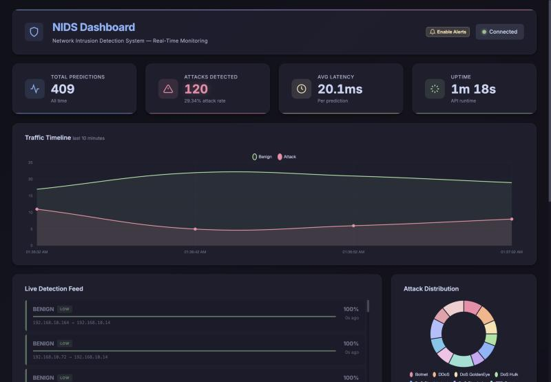
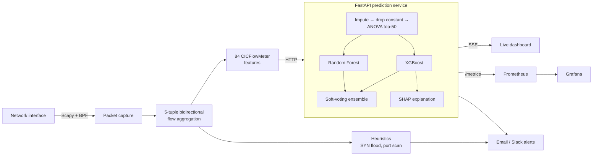

# ML-Based Network Intrusion Detection System

[](https://github.com/C00286234/ML-Based-NIDS/actions/workflows/ci.yml)


A real-time intrusion detection system that classifies network flows as benign or one of 13 attack
types, explains each decision with SHAP, and streams detections to a live dashboard. It is trained on
the re-labelled [CIC-IDS2017](#dataset) dataset, with an evaluation built to avoid the data-leakage
mistakes common in published IDS results.



## Results

On a **held-out test set of 312,656 flows** that was never used for training, tuning or model
selection:

| | Deployed model |
|---|---|
| Accuracy | **99.52%** |
| Attack detection rate | **99.99%** |
| False positive rate | **0.004%** (about 1 false alarm per 24,000 benign flows) |
| Macro F1 (classes with 30+ test flows) | **0.990** |
| Latency, one flow | 6.4 ms (SHAP explanation: +11 ms) |
| Throughput, batched | 25,000 flows/s |

Full per-class results and the confusion matrix are in [reports/REPORT.md](reports/REPORT.md).
Run `nids evaluate` to reproduce them.

The hardest pair is **Portscan vs Infiltration – Portscan** (about 93–97% F1). Both are the same
nmap scans. The only difference is whether the scanner is an outside attacker or an internal machine
that has already been compromised, and per-flow statistics can't see that. Telling them apart would
need host context, such as the source being an internal address that recently downloaded something.

## How it works



- **Model:** a Random Forest and an XGBoost classifier, combined by weighted probability averaging.
  The weight is chosen on the validation split by log-loss. On this dataset the two models score
  within noise of each other (validation log-loss 0.0113–0.0119 for every weight), and the rule
  picks XGBoost on its own. The ensemble is kept because the data, not a default, decides the weight
  each time it is retrained, and Random Forest still provides a second opinion
  (`model_agreement` in every response). SMOTE oversamples rare attack classes, on the training
  split only.
- **One model object everywhere:** [`NIDSModel`](nids/ml/model.py) bundles preprocessing, both
  classifiers, the ensemble weight and SHAP. Training, evaluation and the API all use it, so the
  reported numbers come from exactly the model being served.
- **Explainability:** every `/predict` response includes the five features that pushed the decision
  most, with their raw (unscaled) values.
- **Live capture:** the engine builds flows from packets and computes the same 84 features
  CICFlowMeter does. Two simple heuristics (SYN flood, port scan) catch patterns that span many
  flows, which a per-flow model can't see.
- **Operations:** API key auth, rate limiting, Prometheus metrics, a pre-built Grafana dashboard,
  Email/Slack alerting with cooldowns, and Docker Compose for the whole stack.

## Quick start

### Docker (API, dashboard, Prometheus, Grafana)

```bash
git clone -b v2-portfolio https://github.com/C00286234/ML-Based-NIDS.git && cd ML-Based-NIDS
pip install uv && uv run nids model download    # pre-trained model from GitHub Releases (17 MB)
docker compose up -d
docker compose --profile demo up demo          # replay held-out attack traffic
```

Then open the dashboard at <http://localhost:5001>, the API docs at <http://localhost:8000/docs>,
and Grafana at <http://localhost:3000>.

### Local, from scratch

```bash
uv sync --all-extras                # Python 3.11–3.13; macOS also needs `brew install libomp`
uv run nids data download           # CIC-IDS2017 (improved), 330 MB zip
uv run nids data build              # clean, de-duplicate, split -> data/processed/*.parquet
uv run nids train                   # ~5 min on an M1 Pro; then evaluates on the test split
uv run nids serve                   # API on :8000
uv run nids dashboard               # dashboard on :5001
uv run nids demo                    # replay held-out flows against the API
```

`uv run nids train --quick` trains a smaller model in about a minute.

### Live capture

```bash
uv sync --extra capture
sudo uv run nids engine -i en0      # or --replay data/processed/test.parquet
```

## Methodology: what changed from the original project

This began as my final-year project at South East Technological University (2025/26, supervised by
Omer Ali). The original report and results are kept in [docs/fyp](docs/fyp). Coming back to it later,
I found several problems with how it was evaluated. This version fixes them:

| Problem in v1 | What v2 does |
|---|---|
| "Attempted" attack flows (attacks that never did anything malicious) were merged into the attack labels, so the model learned that benign-looking traffic is an attack | Relabelled as benign, as the [dataset authors recommend](https://intrusion-detection.distrinet-research.be/CNS2022/Dataset_Download.html). This removed most of the "XSS" and "Brute Force" flows, which explains why v1 kept confusing those two |
| Live-API test scripts sampled flows from the full dataset, including training rows | One fixed, saved test split. Everything is measured on it, and the demo replays only those flows |
| Exact duplicate rows were kept, so identical flows could land in both training and test | 15,606 duplicates and conflicting rows removed before splitting |
| The README described an RF + XGBoost ensemble, but only the single best model was ever evaluated | The deployed ensemble is evaluated, alongside each model on its own |
| `Src Port` was a feature. It's an OS-chosen ephemeral port, so the model can learn the lab machines rather than the attacks | Excluded, along with the six bulk features the live engine can't compute (always 0 live) |
| Severity table used label names that don't exist (`PortScan`, `Bot`), so those alerts quietly defaulted to "medium" | Fixed, and a test checks that every class has a severity |
| Hard-coded Windows paths, five `requirements.txt` files, scripts run by number | An installable package with one `nids` CLI, `uv.lock`, tests and CI |

Other decisions:

- **Web attacks merged into one class.** With attempted flows removed, only 104 real web-attack flows
  remain (73 brute force, 18 XSS, 13 SQL injection). Flow statistics can't tell them apart, because
  the difference is in the HTTP payload.
- **Two macro F1 scores.** Macro F1 weights every class equally, and Heartbleed has a single test
  flow, so one miss moves the score by about 0.07. The report shows macro F1 over all classes and over
  classes with 30+ test flows.

## Limitations

- **One dataset.** CIC-IDS2017 is a five-day lab capture. Scores this high are typical of in-dataset
  evaluation and drop sharply on other networks. The next step would be cross-dataset testing on
  CSE-CIC-IDS2018 (the same authors published an improved version).
- **Live features are a re-implementation.** The engine computes CICFlowMeter's features itself. It
  matches the definitions, but small differences in flow timeouts and edge cases mean live traffic
  isn't guaranteed to look exactly like the training data.
- **Supervised only.** The model recognises the attack types it was trained on. A new kind of attack
  that looks like benign traffic will be missed. An anomaly detector trained on benign traffic would
  be a natural addition.

## Project layout

```
nids/
  ml/          dataset.py (download, clean, split) · train.py · evaluate.py · model.py (NIDSModel)
  api/         FastAPI app, API-key auth, rate limiting
  engine/      packet capture, flow aggregation, feature extraction, alerting
  dashboard/   Flask dashboard (SSE live feed)
  cli.py       the `nids` command
  demo.py      replays held-out flows against the API
tests/         unit and API tests (synthetic data, no dataset needed)
reports/       evaluation report, metrics.json, confusion matrix
monitoring/    Prometheus config and Grafana dashboard
docker/        container image
scripts/       load testing, pcap tools
docs/fyp/      the original final-year report and results
```

## API

| Endpoint | |
|---|---|
| `POST /predict` | One flow (84 named features, `null` allowed) → label, confidence, probabilities, top-5 SHAP features. `?explain=false` skips SHAP |
| `POST /batch_predict` | Up to 1000 flows as ordered lists of 84 values |
| `GET /model` | Training metadata and held-out test results |
| `GET /features`, `/classes` | Expected inputs and output classes |
| `GET /api/recent`, `/api/stream` | Recent detections, and a server-sent-events live feed |
| `GET /health`, `/stats`, `/metrics` | Health, usage stats, Prometheus metrics |

Set `NIDS_REQUIRE_AUTH=true` and `NIDS_API_KEY=...` to require an `X-API-Key` header.

## Dataset

Engelen, G., Rimmer, V., & Joosen, W. (2021). *Troubleshooting an Intrusion Detection Dataset: the
CICIDS2017 Case Study.* IEEE Security and Privacy Workshops. The re-labelled data is at
<https://intrusion-detection.distrinet-research.be/CNS2022/>. It is based on CIC-IDS2017 by the
Canadian Institute for Cybersecurity (Sharafaldin et al., 2018).

## License

GPL-3.0. See [LICENSE](LICENSE).
