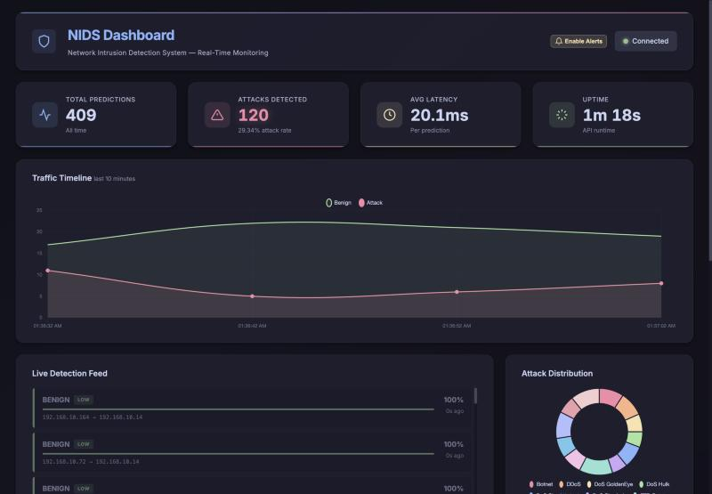
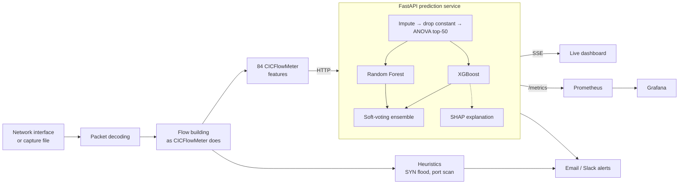

# ML-Based Network Intrusion Detection System

[](https://github.com/C00286234/ML-Based-NIDS/actions/workflows/ci.yml)


A real-time intrusion detection system that classifies network flows as benign or one of 13 attack
types, explains each decision with SHAP, and streams detections to a live dashboard. It is trained on
the re-labelled [CIC-IDS2017](#dataset) dataset, with an evaluation built to avoid the data-leakage
mistakes common in published IDS results.



## Results

On a **held-out test set of 312,431 flows**. The split is by time: on each day the model trains on
the earliest 70% of each attack and is tested on the last 15%, so no test flow has a near-copy in
the training set. The test set was used once, for the final model.

| | Deployed model |
|---|---|
| Accuracy | **99.16%** |
| Attack detection rate | **99.18%** |
| False positive rate | **0.003%** (about 1 false alarm per 30,000 benign flows) |
| Right attack family | 99.79% |
| Macro F1 (classes with 30+ test flows) | 0.893 |
| Latency, one flow | 6.8 ms (SHAP explanation: +11 ms) |
| Throughput, batched | 25,000 flows/s |

Per-class results, confidence intervals, alert-threshold settings and calibration are in
[reports/REPORT.md](reports/REPORT.md). Run `nids evaluate` to reproduce them.

Where it falls short:

- **The end of a slow DoS attack.** The model calls 46% of Slowloris and 70% of Slowhttptest flows
  in the test period benign. Those last minutes are the attack winding down, when the connections
  it held open are finally closed, and they look unlike the build-up the model trained on. Every
  other class with 30+ test flows has recall of 92% or better.
- **Portscan vs Infiltration – Portscan** (F1 0.96 and 0.91). Both are the same nmap scans. The only
  difference is whether the scanner is an outside attacker or an internal machine that has already
  been compromised, and per-flow statistics can't see that.
- **Attacks it has never seen.** With an attack type held out of training, the model still flags it
  if it resembles a known one (a held-out DDoS: 96%), and misses it otherwise (a held-out botnet or
  SSH brute-force: 0%).

## What the experiments showed

`nids experiments` reruns all of these; the tables are in [reports/EXPERIMENTS.md](reports/EXPERIMENTS.md).

- **A random split flatters the model.** The same configuration scores macro F1 0.989 on a random
  split and 0.893 on the time-ordered one. The random split puts neighbouring flows of one attack
  burst on both sides, so the wind-down flows above are in the training set.
- **The destination port was a shortcut.** A model given `Dst Port` detects 99.98% of validation
  attacks, but only 67.7% when the same flows are relabelled with a non-standard port (DoS Hulk:
  100% → 3%). It had learned "port 80 plus this shape". Removing the feature costs nothing on
  validation, so the deployed model does not use it and gives the same answer on any port.
- **Fewer features generalise better.** Keeping the best 50 features by ANOVA F-score holds
  validation false positives at 0.02%. Using all 77 raises that to 0.67%.
- **SMOTE and the ensemble matter little.** SMOTE, class weights and no balancing land within the
  validation set's sampling noise of each other (macro F1 0.981–0.987, 95% interval ±0.003). So do
  Random Forest, XGBoost and their blend. They are kept because they are no worse, not because
  they are needed.
- **An anomaly detector does not catch new attacks here.** An Isolation Forest trained on benign
  traffic flagged almost none of the held-out attacks at a 1% false-alarm budget. It is not shipped.

## How it works



- **Model:** a Random Forest and an XGBoost classifier, combined by weighted probability averaging.
  The weight is chosen on the validation split by log-loss (currently 0.25 Random Forest, 0.75
  XGBoost). The two models score within noise of each other, so the blend matters less than the
  second opinion it gives (`model_agreement` in every response). SMOTE oversamples rare attack
  classes, on the training split only. The model sees 50 flow features and neither port number.
- **One model object everywhere:** [`NIDSModel`](nids/ml/model.py) bundles preprocessing, both
  classifiers, the ensemble weight and SHAP. Training, evaluation and the API all use it, so the
  reported numbers come from exactly the model being served.
- **Explainability:** every `/predict` response includes the five features that pushed the decision
  most, with their raw (unscaled) values.
- **Live capture that matches the training data:** the engine's flow builder is a step-by-step port
  of the CICFlowMeter build that produced the dataset, quirks included. Run on the dataset's own
  packet captures it rebuilds **52,327 of 52,327 flows** with identical endpoints and start times,
  99.98% of them with all 84 features equal, and the model gives the same answer on every one
  ([parity report](reports/PARITY.md)). Two simple rules (SYN flood, port scan) catch patterns
  that span many flows, which a per-flow model can't see.
- **Capture files:** `nids pcap capture.pcap` analyses a pcap or pcapng file with no other services
  running, at around 100,000 packets per second.
- **Operations:** API key auth, rate limiting, Prometheus metrics, a pre-built Grafana dashboard,
  Email/Slack alerting with cooldowns, and Docker Compose for the whole stack.

## Quick start

### Docker (API, dashboard, Prometheus, Grafana)

```bash
git clone https://github.com/C00286234/ML-Based-NIDS.git && cd ML-Based-NIDS
pip install uv && uv run nids model download    # pre-trained model from GitHub Releases (9 MB)
docker compose up -d
docker compose --profile demo up demo          # replay held-out attack traffic
```

Then open the dashboard at <http://localhost:5001>, the API docs at <http://localhost:8000/docs>,
and Grafana at <http://localhost:3000>.

### Local, from scratch

```bash
uv sync --all-extras                # Python 3.11–3.13; macOS also needs `brew install libomp`
uv run nids data download           # CIC-IDS2017 (improved), 330 MB zip
uv run nids data build              # clean, de-duplicate, split -> data/processed/*.parquet
uv run nids train                   # ~5 min on an M1 Pro; then evaluates on the test split
uv run nids experiments             # optional, ~50 min: split comparison, ablations, unseen attacks
uv run nids serve                   # API on :8000
uv run nids dashboard               # dashboard on :5001
uv run nids demo                    # replay held-out flows against the API
```

`uv run nids train --quick` trains a smaller model in about a minute.

### Capture files and live capture

```bash
uv run nids pcap capture.pcap                    # analyse a pcap/pcapng file; prints a summary
uv run nids pcap capture.pcap --out flows.csv    # ...and writes one row per flow

uv run nids engine --pcap capture.pcap           # same file through the API, so it shows on the dashboard
uv sync --extra capture
sudo uv run nids engine -i en0                   # live capture from an interface
```

To try it on real attack traffic, `scripts/pcap_slice.py` downloads a few minutes of the
CIC-IDS2017 captures (which are 8–13 GB per day) without fetching the whole file:

```bash
uv run python scripts/pcap_slice.py friday 2017-07-07T18:56:00 --minutes 3   # the DDoS attack, 154 MB
uv run nids pcap data/pcap/friday_1856_3min.pcap
```

## Methodology: what changed from the original project

This began as my final-year project at South East Technological University (2025/26, supervised by
Omer Ali). The original report and results are kept in [docs/fyp](docs/fyp). Coming back to it later,
I found several problems with how it was evaluated. This version fixes them:

| Problem in v1 | What v2 does |
|---|---|
| "Attempted" attack flows (attacks that never did anything malicious) were merged into the attack labels, so the model learned that benign-looking traffic is an attack | Relabelled as benign, as the [dataset authors recommend](https://intrusion-detection.distrinet-research.be/CNS2022/Dataset_Download.html). This removed most of the "XSS" and "Brute Force" flows, which explains why v1 kept confusing those two |
| Live-API test scripts sampled flows from the full dataset, including training rows | One fixed, saved test split. Everything is measured on it, and the demo replays only those flows |
| The split was random, so each test flow had near-identical neighbours from the same attack burst in training | Split by time: train on the earliest 70% of each attack, test on the last 15%. Macro F1 falls from 0.989 to 0.893, and the difference is a real weakness the random split hid |
| Exact duplicate rows were kept, so identical flows could land in both training and test | 15,539 duplicate and conflicting rows removed before splitting |
| The README described an RF + XGBoost ensemble, but only the single best model was ever evaluated | The deployed ensemble is evaluated, alongside each model on its own |
| `Src Port` and `Dst Port` were features. The source port is an OS-chosen number, so the model can learn the lab machines rather than the attacks. The destination port let it learn "port 80 plus this shape" instead of the shape | Both excluded. Moving services to other ports cut the old model's detection rate to 68%; the new one is unaffected |
| Severity table used label names that don't exist (`PortScan`, `Bot`), so those alerts quietly defaulted to "medium" | Fixed, and a test checks that every class has a severity |
| The live engine measured flows differently from the dataset: packet sizes included headers, idle time used a 1 s threshold instead of 5 s, flows were cut after 10 s or 1,000 packets. On real packets only 4 of the model's 50 features matched the dataset's values, and the engine caught half of an FTP brute-force while raising false alarms on normal traffic | Rewritten as a port of the dataset's CICFlowMeter and checked against the dataset's own captures: every flow rebuilt, 99.98% with all 84 features equal, identical predictions ([report](reports/PARITY.md)). A sample of real packets runs in CI |
| Hard-coded Windows paths, five `requirements.txt` files, scripts run by number | An installable package with one `nids` CLI, `uv.lock`, tests and CI |

Other decisions:

- **Web attacks merged into one class.** With attempted flows removed, only 104 real web-attack flows
  remain (73 brute force, 18 XSS, 13 SQL injection). Flow statistics can't tell them apart, because
  the difference is in the HTTP payload.
- **Two macro F1 scores.** Macro F1 weights every class equally, and Heartbleed has a single test
  flow, so one miss moves the score by about 0.07. The report shows macro F1 over all classes and over
  classes with 30+ test flows.
- **Choices made on validation, measured on test.** The configuration, the ensemble weight and the
  alert thresholds were all chosen on the validation split. The test split was then scored once.
- **The dataset's labels are used as they are.** One example: 955 flows labelled "Infiltration –
  Portscan" are a 14-second scan from the outside attacker, which the model calls "Portscan". That
  counts as an error here.

## Limitations

- **One dataset.** CIC-IDS2017 is a five-day lab capture with one attacker machine and one run of
  each attack. The time-ordered split tests a later part of the same attack, not a different
  attacker or network, where scores usually drop much further. The next step is cross-dataset
  testing on CSE-CIC-IDS2018 (the same authors published an improved version).
- **It has seen one phase of each attack.** As the slow DoS result shows, an attack's later phase
  can look different enough to be missed. More varied training captures are the fix, not tuning.
- **Live detection trades a little accuracy for speed.** The dataset ends a flow 120 s after it
  starts. The live engine can't wait that long, so it also scores a flow after 15 s of silence or
  1 s after the connection closes. On the dataset's captures that keeps 99.6% of the detections
  ([details](reports/PARITY.md#what-faster-detection-costs)). One-packet flows are never scored,
  because the dataset contains none. IPv6 is not supported, because the dataset has none either.
- **Supervised only.** The model recognises attack types it was trained on, and new ones only when
  they resemble those. A per-flow anomaly detector did not help
  ([experiment](reports/EXPERIMENTS.md#attacks-the-model-has-never-seen)); catching a new botnet or
  brute-force campaign needs context across flows and hosts, which this project does not model.

## Project layout

```
nids/
  ml/          dataset.py (download, clean, split) · train.py · evaluate.py · experiments.py ·
               model.py (NIDSModel)
  api/         FastAPI app, API-key auth, rate limiting
  engine/      flowmeter.py (packets -> flows -> 84 features) · pcap.py (file reader) · engine.py
               (live capture / pcap -> API) · analyze.py (`nids pcap`) · heuristics.py · alerting.py
  dashboard/   Flask dashboard (SSE live feed)
  cli.py       the `nids` command
  demo.py      replays held-out flows against the API
tests/         unit and API tests, plus a real-packet sample checked against the dataset's values
reports/       evaluation report, experiments, live-parity report, figures and the raw numbers
monitoring/    Prometheus config and Grafana dashboard
docker/        container image
scripts/       load testing, parity report, capture-slice downloader
docs/fyp/      the original final-year report and results
```

## API

| Endpoint | |
|---|---|
| `POST /predict` | One flow (84 named features, `null` allowed) → label, confidence, attack score, probabilities, top-5 SHAP features. `?explain=false` skips SHAP |
| `POST /batch_predict` | Up to 1000 flows as ordered lists of 84 values |
| `GET /model` | Training metadata and held-out test results |
| `GET /features`, `/classes` | Expected inputs and output classes |
| `GET /api/recent`, `/api/stream` | Recent detections, and a server-sent-events live feed |
| `GET /health`, `/stats`, `/metrics` | Health, usage stats, Prometheus metrics |

Set `NIDS_REQUIRE_AUTH=true` and `NIDS_API_KEY=...` to require an `X-API-Key` header.

## Dataset

Engelen, G., Rimmer, V., & Joosen, W. (2021). *Troubleshooting an Intrusion Detection Dataset: the
CICIDS2017 Case Study.* IEEE Security and Privacy Workshops. The re-labelled data is at
<https://intrusion-detection.distrinet-research.be/CNS2022/>. It is based on CIC-IDS2017 by the
Canadian Institute for Cybersecurity (Sharafaldin et al., 2018).

## License

GPL-3.0. See [LICENSE](LICENSE).
