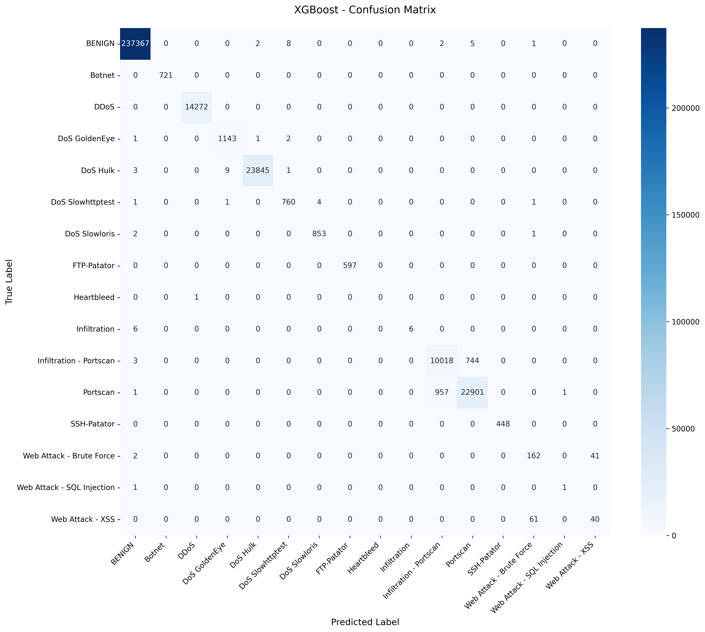
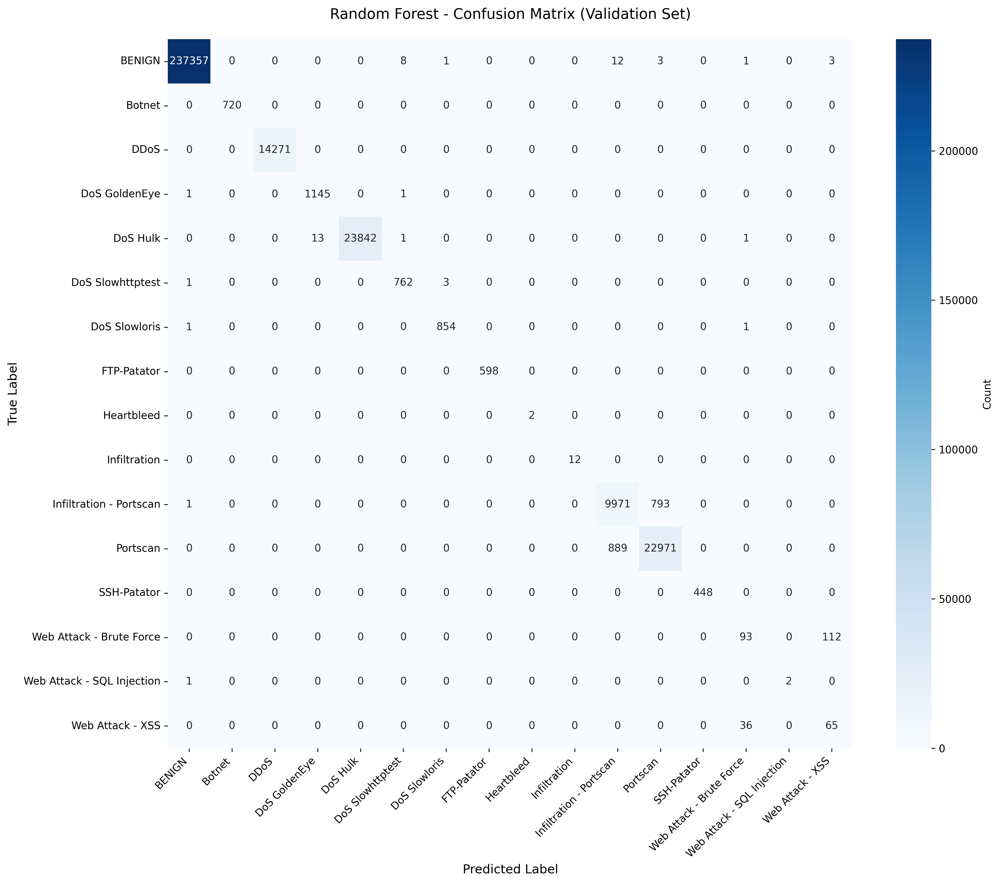
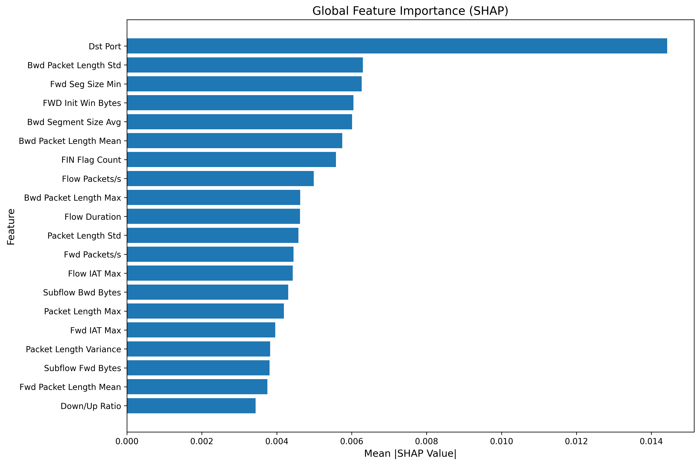

# NIDS System Explanation
## How the System Works — File by File

---

## System Overview

The system is split into two independent processes that run side by side:

```
┌─────────────────────────────────────────────────────────────┐
│  PROCESS 1: NIDS Engine  (src/)                             │
│                                                             │
│  Network Interface (Ethernet 4)                             │
│         │                                                   │
│         ▼                                                   │
│  packet_capture.py  ──→  Captures raw packets               │
│         │                                                   │
│         ▼                                                   │
│  flow_aggregator.py ──→  Groups packets into flows          │
│         │                                                   │
│         ▼                                                   │
│  feature_extractor.py ─→  Computes 84 statistics per flow   │
│         │                                                   │
│         │  HTTP POST /predict                               │
│         ▼                                                   │
└─────────────────────────────────────────────────────────────┘
                          │
                          │  (localhost:8000)
                          │
┌─────────────────────────────────────────────────────────────┐
│  PROCESS 2: ML API  (api/)                                  │
│                                                             │
│  api/app.py  ──→  Receives features                         │
│                   Scales + selects features                 │
│                   Random Forest prediction                  │
│                   XGBoost prediction                        │
│                   Averages both → final label + confidence  │
│                                                             │
│  Returns: { "prediction": "DDoS", "confidence": 0.94 }     │
└─────────────────────────────────────────────────────────────┘
         │
         ▼
  nids_engine.py logs result, triggers alert if attack
```

Both processes are started together by `run_nids.py`.

---

## File 1: `run_nids.py` — The Launcher

**What it does:** Starts both the ML API and the NIDS Engine as separate subprocesses, pipes their output to log files, and keeps them both alive until you press Ctrl+C.

**Why it exists:** The API and Engine are separate programs. This script is the single entry point so you don't have to open two terminals.

### Key code explained:

```python
api_proc = subprocess.Popen(
    [sys.executable, "-u", os.path.join(ROOT, "api", "app.py")],
    stdout=subprocess.PIPE,
    stderr=subprocess.STDOUT,
)
```
This launches `api/app.py` as a child process — the same as typing `python api/app.py` in a terminal. `subprocess.PIPE` captures its output so the launcher can write it to a log file.

```python
for i in range(30):
    time.sleep(1)
    try:
        r = requests.get("http://localhost:8000/health", timeout=2)
        if r.status_code == 200:
            break
```
Before starting the Engine, the launcher polls the API's `/health` endpoint every second for up to 30 seconds. This ensures the models are fully loaded before the Engine starts sending it flow data.

```python
engine_cmd = [sys.executable, "-u", os.path.join(ROOT, "src", "nids_engine.py")]
if args.interface:
    engine_cmd += ["--interface", args.interface]
```
When you run `python run_nids.py -i "Ethernet 4"`, the `-i` flag is forwarded here into the engine command.

---

## File 2: `src/packet_capture.py` — Raw Packet Capture

**What it does:** Uses Scapy to listen on a network interface and capture every IP packet. Stores captured packets in a thread-safe queue for the rest of the pipeline to consume.

**Key concept:** This runs in its own background thread so it never blocks the main engine loop.

### Key code explained:

```python
def _packet_callback(self, packet) -> None:
    if not packet.haslayer(IP):
        return
```
Scapy calls this function for every packet it sees. The first check discards anything that isn't an IP packet (e.g. ARP, raw Ethernet frames) — the NIDS only cares about IP traffic.

```python
captured = CapturedPacket(
    timestamp=float(packet.time),
    src_ip=ip_layer.src,
    dst_ip=ip_layer.dst,
    protocol=ip_layer.proto,   # 6=TCP, 17=UDP, 1=ICMP
    length=len(packet),
    ...
)
```
Rather than storing the raw Scapy packet object (which is large and complex), it extracts only the fields the rest of the pipeline needs into a lightweight `CapturedPacket` dataclass.

```python
sniff(
    iface=self.interface,
    prn=self._packet_callback,
    store=False,
    filter=self.bpf_filter,           # "ip" — kernel-level filter
    stop_filter=lambda _: self._stop_event.is_set()
)
```
`store=False` tells Scapy NOT to keep packets in memory — the callback handles them immediately and they're discarded. This prevents memory growing infinitely during long captures. The BPF filter `"ip"` is applied at the kernel level before packets even reach Python, which is much more efficient than filtering in Python.

---

## File 3: `src/flow_aggregator.py` — Packet → Flow Grouping

**What it does:** Takes individual packets and groups them into **flows**. A flow is all packets between the same two endpoints (same source IP, destination IP, source port, destination port, and protocol). This is critical because the ML model classifies flows, not individual packets.

**Key concept:** A ping from Kali generates many ICMP packets — the aggregator groups them all into one flow, then computes statistics across that whole conversation.

### Key code explained:

```python
fwd_id = f"{packet.src_ip}:{packet.src_port}-{packet.dst_ip}:{packet.dst_port}-{packet.protocol}"
bwd_id = f"{packet.dst_ip}:{packet.dst_port}-{packet.src_ip}:{packet.src_port}-{packet.protocol}"

if fwd_id in self._flows:
    return fwd_id, True
elif bwd_id in self._flows:
    return bwd_id, False
```
This is how **bidirectional flows** work. When Kali pings your Windows machine, the request goes `192.168.56.103 → 192.168.56.1` (forward) and the reply goes `192.168.56.1 → 192.168.56.103` (backward). Both directions are grouped into one flow using the same ID, just tracking which side each packet came from. This matters because the ML model uses separate statistics for forward vs backward traffic.

```python
def _should_complete_flow(self, flow: Flow) -> bool:
    if flow.total_packets >= self.max_packets_per_flow:
        return True
    if flow.protocol == 6:  # TCP only
        if flow.fwd_fin_flags > 0 and flow.bwd_fin_flags > 0:
            return True
        if flow.total_rst_flags > 0:
            return True
    return False
```
A flow is marked "done" in two ways:
- **TCP**: When both sides send FIN (graceful close) or either side sends RST (abrupt close). This means TCP flows complete quickly and naturally.
- **Any protocol**: When 1000 packets are reached (safety cap).
- **Timeout** (ICMP/UDP): When no new packet arrives for 10 seconds (`flow_timeout` in config). This is handled separately in `cleanup_expired_flows()` which runs every 5 seconds.

This is why ICMP (ping) flows take longer — there's no FIN/RST, so they rely on the timeout.

---

## File 4: `src/feature_extractor.py` — Flow → 84 Numbers

**What it does:** Takes a completed flow and computes 84 statistical features from it. These 84 numbers are what the ML model actually sees — it knows nothing about raw packets.

**Key concept:** The ML model was trained on the CIC-IDS2017 dataset which uses these exact 84 features. The extractor must reproduce them exactly or predictions will be wrong.

### Key code explained:

```python
FEATURE_NAMES = [
    "Src Port", "Dst Port", "Protocol", "Flow Duration",
    "Total Fwd Packet", "Total Bwd packets",
    "Fwd Packet Length Max", "Fwd Packet Length Min", "Fwd Packet Length Mean",
    ...
    "Active Mean", "Active Std", "Active Max", "Active Min",
    "Idle Mean", "Idle Std", "Idle Max", "Idle Min",
    "ICMP Code", "ICMP Type", "Total TCP Flow Time"
]
```
These 84 names must match exactly what the model was trained on. They are grouped into:
- **Basic info**: Ports, protocol, duration
- **Packet counts/lengths**: How many packets, how big they are, in each direction
- **Inter-arrival times (IAT)**: Time gaps between packets — attack traffic often has very different timing than normal traffic
- **TCP flags**: Counts of SYN, FIN, RST, ACK etc. — a SYN flood has thousands of SYN with no ACK
- **Rates**: Packets per second, bytes per second
- **Active/idle times**: Periods of activity vs silence within the flow

```python
fwd_pkts = [p.length for p in flow.fwd_packets]
fwd_max  = safe_max(fwd_pkts)
fwd_mean = safe_mean(fwd_pkts)
fwd_std  = safe_stdev(fwd_pkts)
```
`safe_max/mean/stdev` are wrappers that return 0.0 instead of crashing when a list is empty (e.g. a flow with only backward packets). This is important for stability.

---

## File 5: `src/nids_engine.py` — The Orchestrator

**What it does:** The central controller. It starts and connects all the components (capture → aggregation → feature extraction → prediction), runs the main processing loop, and handles results.

### Key code explained:

```python
self._prediction_pool = ThreadPoolExecutor(
    max_workers=4,
    thread_name_prefix="nids-predict"
)
```
API calls can take 10–100ms each. If the engine waited for each one before processing the next flow, it would fall behind under heavy traffic. Instead, predictions are submitted to a **thread pool** — up to 4 can run simultaneously while the main loop keeps processing new packets without waiting.

```python
def _process_flows(self) -> int:
    completed_flows = self.flow_aggregator.get_completed_flows()

    for flow in completed_flows:
        features = self.feature_extractor.extract_features(flow)

        future = self._prediction_pool.submit(
            self._predict_and_handle, flow, features
        )
        self._pending_futures.append(future)
```
This is the core pipeline step: get completed flows → extract features (fast, runs inline) → submit prediction to thread pool (slow, runs in background). The main loop doesn't wait for the prediction — it immediately moves on to the next flow.

```python
def _handle_prediction(self, flow, features, prediction):
    threshold = alert_config.get("confidence_threshold", 0.8)
    is_attack = prediction.get("is_attack", False)
    confidence = prediction.get("confidence", 0.0)

    if is_attack and confidence >= threshold:
        self._attack_logger.warning(attack_msg)
        self.alert_manager.send_attack_alert(...)
```
Only fires an alert when BOTH conditions are true: the model predicted an attack AND confidence is above 0.8. This threshold prevents low-confidence predictions (like the 44% SSDP false positive you saw) from triggering alerts.

```python
def _main_loop(self):
    while not self._stop_event.is_set():
        # Drain the packet queue into flows
        packets = self.packet_capture.get_packets(max_count=batch_size)
        for packet in packets:
            self.flow_aggregator.process_packet(packet)

        # Process completed flows
        self._process_flows()

        # Periodically expire timed-out flows
        if current_time - last_cleanup > cleanup_interval:
            self.flow_aggregator.cleanup_expired_flows()

        time.sleep(0.1)  # 100ms tick
```
The main loop runs every 100ms. Each tick it: drains packets from the capture queue, feeds them into the flow aggregator, processes any completed flows, and occasionally runs cleanup for timed-out flows.

---

## File 6: `api/app.py` — The ML Prediction API

**What it does:** A FastAPI web server that receives 84 features, runs them through the trained RF and XGBoost models, and returns a classification with confidence score.

**Key concept:** This runs as a completely separate process from the engine. They communicate via HTTP. This means the API can be updated or restarted independently.

### Key code explained:

```python
def preprocess_features(features_input):
    # Build full 84-feature vector (filling missing with 0)
    feature_vector = [features_input.get(name, 0.0) for name in FEATURE_NAMES_84]
    df = pd.DataFrame([feature_vector], columns=FEATURE_NAMES_84)

    # Apply same scaler fitted during training
    scaled = state.scaler.transform(df)

    # Select same 50 features chosen during training
    selected = state.feature_selector.transform(scaled)
    return selected
```
The three steps here must exactly mirror what was done during training:
1. Build the 84-feature vector in the right order
2. Apply `StandardScaler` (the same one saved from training — fitted on training data only)
3. Apply `SelectKBest` feature selector (selects the same 50 features chosen during training)

If any of these steps differ from training, predictions will be garbage.

```python
def _ensemble_proba(rf_model, xgb_model, X):
    rf_probs  = rf_model.predict_proba(X)   # [0.01, 0.02, 0.94, ...]  16 values
    xgb_probs = xgb_model.predict_proba(X)  # [0.02, 0.01, 0.92, ...]  16 values
    return rf_probs, xgb_probs, (rf_probs + xgb_probs) / 2.0
```
Both models output a **probability distribution** over 16 classes — each number is "how confident is this model that the flow belongs to this class". The ensemble simply averages the two distributions. The class with the highest average probability becomes the prediction.

```python
prediction_idx = int(np.argmax(ensemble_probs))
predicted_label = state.label_encoder.inverse_transform([prediction_idx])[0]
confidence = float(ensemble_probs[prediction_idx])
is_attack = predicted_label != "BENIGN"
```
`argmax` finds the index of the highest probability. `label_encoder.inverse_transform` converts the number (e.g. `3`) back to the string label (e.g. `"DDoS"`). Anything that isn't `"BENIGN"` is considered an attack.

---

## File 7: `src/constants.py` — The Feature List

**What it does:** Stores the single authoritative list of 84 feature names. All scripts that need this list import from here instead of each defining their own copy.

**Why it matters:** The order of this list is critical. `api/app.py` builds the feature vector by iterating through this list:
```python
feature_vector = [features_input.get(name, 0.0) for name in FEATURE_NAMES_84]
```
If feature 3 is `"Flow Duration"` in training but `"Protocol"` at prediction time, the model receives scrambled input and will predict nonsense. The list must be identical to what was used during training.

---

## File 8: `04_model_training_improved.py` — How Models Are Built

**What it does:** A one-time script (not part of the live system) that trains the RF and XGBoost models and saves them to `models/`. You run this once; the saved files are what `api/app.py` loads.

### Key code explained:

```python
# 70% train, 15% validation, 15% test — stratified
X_train, X_temp, y_train, y_temp = train_test_split(
    X, y_encoded, test_size=0.30, stratify=y_encoded
)
X_val, X_test, y_val, y_test = train_test_split(
    X_temp, y_temp, test_size=0.50, stratify=y_temp
)
```
**Stratified** splitting means every split has the same class proportions. Without this, a small class like Heartbleed (very few samples) might end up entirely in training with none in test, making evaluation misleading.

```python
smote = SMOTE(sampling_strategy=target_counts, k_neighbors=k_neighbors)
X_resampled, y_resampled = smote.fit_resample(X_train, y_train)
```
SMOTE is applied **only to the training data**, never to validation or test. Applying it to test data would be data leakage — the model would be evaluated on synthetic data it helped create, making metrics artificially inflated.

```python
xgb_model = XGBClassifier(
    early_stopping_rounds=10,
    eval_metric='mlogloss'
)
xgb_model.fit(X_train, y_train, eval_set=[(X_val, y_val)])
```
**Early stopping** monitors validation loss during training. If it doesn't improve for 10 consecutive rounds, training stops. This prevents overfitting — the model learns the training data so well it stops generalising to new traffic.

```python
# Primary metric is macro F1, not accuracy
PRIMARY_METRIC = 'f1_macro'
```
**Why macro F1 and not accuracy?** If 99% of traffic is BENIGN, a model that predicts BENIGN for everything achieves 99% accuracy but detects zero attacks. Macro F1 computes F1 separately for each of the 16 classes and averages them — a rare attack class like Heartbleed counts equally to DDoS. This forces the model to actually learn all attack types.

---

## How It All Fits Together — End to End

Here is the complete journey of one ping from Kali VM to a NIDS prediction:

```
1. Kali sends ICMP echo request to 192.168.56.1

2. packet_capture.py (running on Ethernet 4) sees the packet
   → Extracts: src=192.168.56.103, dst=192.168.56.1, proto=ICMP, len=74
   → Puts CapturedPacket into the queue

3. nids_engine.py main loop drains the queue
   → Calls flow_aggregator.process_packet(packet)

4. flow_aggregator.py looks up flow ID "192.168.56.103:0-192.168.56.1:0-1"
   → No existing flow → creates new Flow object
   → Adds packet as a forward packet
   → (More pings arrive, all added to the same flow)

5. After 10 seconds of no new pings → cleanup_expired_flows() fires
   → Flow is marked complete, moved to completed queue

6. nids_engine.py calls _process_flows()
   → feature_extractor.extract_features(flow) computes 84 statistics
   → Submits to thread pool: _predict_and_handle(flow, features)

7. Thread pool worker sends HTTP POST to localhost:8000/predict
   → Body: { "features": { "Src Port": 0, "Dst Port": 0, ..., 84 values } }

8. api/app.py receives request
   → preprocess_features(): scale → select 50 features
   → _ensemble_proba(): RF probabilities + XGBoost probabilities → average
   → argmax → class index 0 → "BENIGN"
   → Returns: { "prediction": "BENIGN", "confidence": 0.851, "is_attack": false }

9. nids_engine.py _handle_prediction()
   → Logs to predictions.log
   → confidence < threshold OR is_attack=false → no alert triggered
   → Prints to console: "[ ] BENIGN  conf=85%  192.168.56.103:0 -> 192.168.56.1:0"
```

---

## Config File: `config/nids_config.yaml`

Controls the live behaviour of the system without touching code:

```yaml
flow:
  timeout: 10.0        # Seconds of inactivity before a flow expires (affects latency)
  max_packets: 1000    # Flow completes at 1000 packets regardless of timeout

alerts:
  confidence_threshold: 0.8   # Predictions below 80% confidence don't trigger alerts

performance:
  cleanup_interval: 5    # How often (seconds) to check for expired flows
  stats_interval: 10     # How often to print the statistics panel
```

The two values most relevant to your testing:
- **`flow.timeout`**: Lower = faster predictions, but short-lived flows may not accumulate enough packets for accurate classification
- **`alerts.confidence_threshold`**: Higher = fewer false positives, but may miss low-confidence real attacks

---

## Features

- **ML Classification** — Random Forest + XGBoost ensemble detecting 15 attack types
- **Real-Time Detection** — Live packet capture via Scapy, 5-tuple flow aggregation, and 84-feature extraction
- **Explainability** — SHAP and LIME explanations for every prediction (top 5 contributing features)
- **REST API** — FastAPI with Swagger docs, batch prediction, rate limiting, and optional API key auth
- **Alerting** — Email (Gmail/Outlook SMTP) and Slack webhook notifications with configurable severity thresholds and cooldown periods
- **Session Logging** — Timestamped session directories with separate engine, prediction, attack, and summary logs per run
- **One-Command Launch** — `run_nids.py` starts both the API server and NIDS engine together
- **Monitoring** — Prometheus metrics + pre-built Grafana dashboard (latency, attack trends, model health)
- **Flask Dashboard** — Lightweight real-time status page with auto-refresh and attack distribution charts
- **Benchmarking & Evaluation** — Performance benchmarks (latency/throughput) and randomised accuracy testing with confidence intervals
- **Docker Support** — Single `docker-compose up` deploys the full stack (API + Prometheus + Grafana)

---

## Project Structure

```
FYP-NIDS-ML/
├── api/                            # FastAPI prediction service
│   ├── app.py                      # Main API (endpoints, model loading, SHAP)
│   ├── auth.py                     # API key authentication
│   ├── rate_limit.py               # Rate limiting middleware
│   ├── test_client.py              # API test suite
│   └── requirements.txt
│
├── src/                            # Real-time NIDS engine
│   ├── nids_engine.py              # Main orchestrator (session logging)
│   ├── packet_capture.py           # Scapy packet capture
│   ├── flow_aggregator.py          # 5-tuple flow aggregation
│   ├── feature_extractor.py        # 84-feature extraction
│   ├── alerting.py                 # Email + Slack alert management
│   ├── constants.py                # Shared feature name definitions
│   └── requirements.txt
│
├── testing/                        # Kali Linux attack testing suite
│   ├── vulnerable_webapp.py        # Intentionally vulnerable Flask app
│   ├── setup_services.py           # FTP/SSH test service setup
│   ├── run_kali_tests.py           # Automated Kali attack runner
│   ├── parse_kali_results.py       # Results parser
│   └── verify_interface.py         # Network interface checker
│
├── dashboard/                      # Flask monitoring UI
│   ├── app.py                      # Dashboard routes
│   ├── templates/index.html        # Web interface
│   └── static/style.css            # Dark theme (Catppuccin Mocha)
│
├── monitoring/                     # Prometheus + Grafana configs
│   ├── prometheus/prometheus.yml
│   └── grafana/
│       ├── provisioning/           # Auto-configure datasource
│       └── dashboards/             # Pre-built NIDS dashboard
│
├── figures/                        # Generated visualisations
│   ├── shap/                       # SHAP explanations
│   └── lime/                       # LIME explanations
│
├── results/                        # Evaluation & benchmark results (CSV/TXT)
├── config/nids_config.yaml         # NIDS engine configuration
│
├── 02_data_preprocessing.py        # Cleaning & label consolidation
├── 03_feature_engineering.py       # Feature scaling & selection
├── 04_model_training_improved.py   # RF + XGBoost training pipeline
│
├── run_nids.py                     # One-command launcher (API + engine)
├── demo_traffic_simulator.py       # Interactive demo (replays CIC-IDS2017 flows)
├── benchmark_suite.py              # Performance benchmarks
├── randomised_evaluation.py        # Randomised accuracy evaluation
├── test_attack_detection.py        # Attack detection validation
│
├── Dockerfile                      # Multi-stage API container
├── docker-compose.yml              # Full stack orchestration
└── .dockerignore
```

---

## API Reference

| Method | Endpoint | Description | Rate Limit |
|---|---|---|---|
| `GET` | `/` | Welcome message + endpoint list | — |
| `GET` | `/health` | Health check (model status, uptime) | — |
| `GET` | `/stats` | Usage statistics (predictions, attack distribution) | — |
| `GET` | `/metrics` | Prometheus metrics (text format) | — |
| `GET` | `/features` | List of 84 required feature names | — |
| `GET` | `/classes` | List of 16 classes (15 attacks + BENIGN) | — |
| `POST` | `/predict` | Single flow prediction + SHAP explanation | 60/min |
| `POST` | `/batch_predict` | Batch prediction (up to 1000 flows) | 30/min |
| `GET` | `/docs` | Interactive Swagger documentation | — |

---

## Model Performance

Evaluated on a held-out test set (311,746 flows):

| Metric | XGBoost | Random Forest |
|---|---|---|
| Accuracy | 99.44% | 99.40% |
| F1 (macro) | 0.8337 | 0.8732 |
| Precision (macro) | 0.8780 | 0.8753 |
| Recall (macro) | 0.8123 | 0.8771 |

Randomised evaluation with balanced class sampling (3 runs, 10 samples/class):

| Metric | Value |
|---|---|
| Overall Accuracy | 91.9% ± 1.2% |
| 95% Confidence Interval | [90.5%, 93.3%] |

### Confusion Matrices

<p align="center">
  
  
</p>

### Feature Importance (SHAP)

<p align="center">
  
</p>

### Known Limitations

The model underperforms on two classes due to limited training samples in CIC-IDS2017:

| Class | Accuracy (randomised eval) | Dataset Samples |
|---|---|---|
| Web Attack - XSS | 53.3% | 652 |
| Web Attack - Brute Force | 76.7% | 1,507 |

All other classes achieve accuracy above 80%, with most reaching 100% in randomised evaluation. The weak performance on web attack classes is a dataset-imbalance problem rather than a modelling issue — these two classes are severely underrepresented in CIC-IDS2017 and there is insufficient data for the model to learn their full diversity.

An additional limitation affects live detection: the model was trained on flow features computed by CICFlowMeter from captured PCAPs, while the live engine extracts features directly from Scapy captures. Subtle differences in flow boundaries, timing precision, and feature computation create a distribution shift that causes the model to misclassify live attack traffic even when it correctly classifies replayed dataset flows.

---

## Monitoring

### Flask Dashboard (port 5001)

Real-time status page showing current attack counts, system health, and attack distribution. Auto-refreshes every 5 seconds.

### Grafana (port 3000)

Pre-built dashboard with 11 panels:
- **Overview** — Total predictions, attacks detected, attack rate %, avg latency
- **Traffic Over Time** — Predictions and attacks as time-series graphs
- **Performance** — Latency percentiles (p50/p95/p99), API request rate
- **Breakdown** — Attack type distribution (pie chart), model status, top attack types

### Prometheus (port 9090)

Scrapes the API every 15 seconds. Key metrics:
- `nids_predictions_total` — Total predictions (by class)
- `nids_attacks_detected_total` — Attacks detected (by type)
- `nids_prediction_latency_seconds` — Prediction latency histogram
- `nids_models_loaded` — Model load status gauge

---

## Alerting

The NIDS engine sends real-time alerts when attacks are detected, configurable via `config/nids_config.yaml`.

### Email (SMTP)

Supports Gmail, Outlook, and custom SMTP servers with HTML-formatted alert emails.

```yaml
alerting:
  email:
    enabled: true
    smtp_server: smtp.gmail.com
    smtp_port: 587
    sender: nids-alerts@example.com
    password: ${NIDS_EMAIL_PASSWORD}
    recipients:
      - security-team@example.com
    min_confidence: 0.9
    cooldown_minutes: 5
    severity_threshold: medium
```

### Slack (Webhook)

Posts attack alerts to a Slack channel via incoming webhook.

```yaml
alerting:
  slack:
    enabled: true
    webhook_url: ${NIDS_SLACK_WEBHOOK}
    channel: "#nids-alerts"
    min_confidence: 0.8
    cooldown_minutes: 2
    severity_threshold: medium
```

Alerts include attack type, severity level, confidence score, source/destination IPs, and top contributing features. Cooldown periods prevent alert flooding during sustained attacks.

---

## Testing & Evaluation

### Benchmark Suite

Measures system performance under load:

```bash
python benchmark_suite.py
```

Reports latency percentiles (p50/p95/p99), single-prediction vs batch throughput, and concurrent request handling. Results are saved to `results/`.

### Randomised Evaluation

Runs attack detection tests with different random seeds and larger samples to produce statistically robust results:

```bash
python randomised_evaluation.py
```

Outputs mean accuracy with standard deviation and 95% confidence intervals across multiple runs.

### Attack Detection Validation

Tests the API against known attack samples from the CIC-IDS2017 dataset:

```bash
python test_attack_detection.py
```

Reports per-class accuracy, precision, recall, and overall detection rates.

### Kali Linux Live Testing

The `testing/` directory contains tools for generating real attack traffic against the NIDS using Kali Linux:

- `vulnerable_webapp.py` — Intentionally vulnerable Flask app (SQL injection, XSS, brute-force targets)
- `setup_services.py` — Sets up FTP/SSH services for brute-force testing
- `run_kali_tests.py` — Automated attack runner using Hydra, Nmap, and Slowloris
- `parse_kali_results.py` — Parses Kali tool output into structured results

---

## Configuration

### Environment Variables

| Variable | Default | Description |
|---|---|---|
| `NIDS_LOG_LEVEL` | `INFO` | Logging level |
| `NIDS_REQUIRE_AUTH` | `false` | Enable API key authentication |
| `NIDS_API_KEY` | — | API key (if auth enabled) |
| `NIDS_RATE_LIMIT` | `100/minute` | Global rate limit |
| `NIDS_PREDICT_RATE_LIMIT` | `60/minute` | Predict endpoint rate limit |
| `NIDS_BATCH_RATE_LIMIT` | `30/minute` | Batch predict rate limit |
| `NIDS_DEBUG` | `false` | Enable hot-reload (dev only) |
| `NIDS_CORS_ORIGINS` | `http://localhost:5001,http://localhost:3000` | Allowed CORS origins |
| `NIDS_API_URL` | `http://localhost:8000` | API URL (for dashboard) |
| `DASHBOARD_PORT` | `5001` | Flask dashboard port |
| `REFRESH_INTERVAL` | `5` | Dashboard refresh rate (seconds) |
| `FLASK_SECRET_KEY` | auto-generated | Flask session secret |
| `NIDS_EMAIL_PASSWORD` | — | SMTP password for email alerts |
| `NIDS_SLACK_WEBHOOK` | — | Slack incoming webhook URL for alerts |

### NIDS Engine Config

The real-time engine is configured via `config/nids_config.yaml`:
- Network interface (default: WiFi, auto-detected)
- Flow timeout (10s) and max flow limits
- API connection details and retry logic
- Email + Slack alerting with severity thresholds and cooldown periods
- Session-based logging to `logs/sessions/`
- Performance tuning (batch size, cleanup interval 5s, stats interval 10s)
- Heuristic detector thresholds (SYN flood: 20 flows/10s; port scan: 15 distinct ports/30s)
