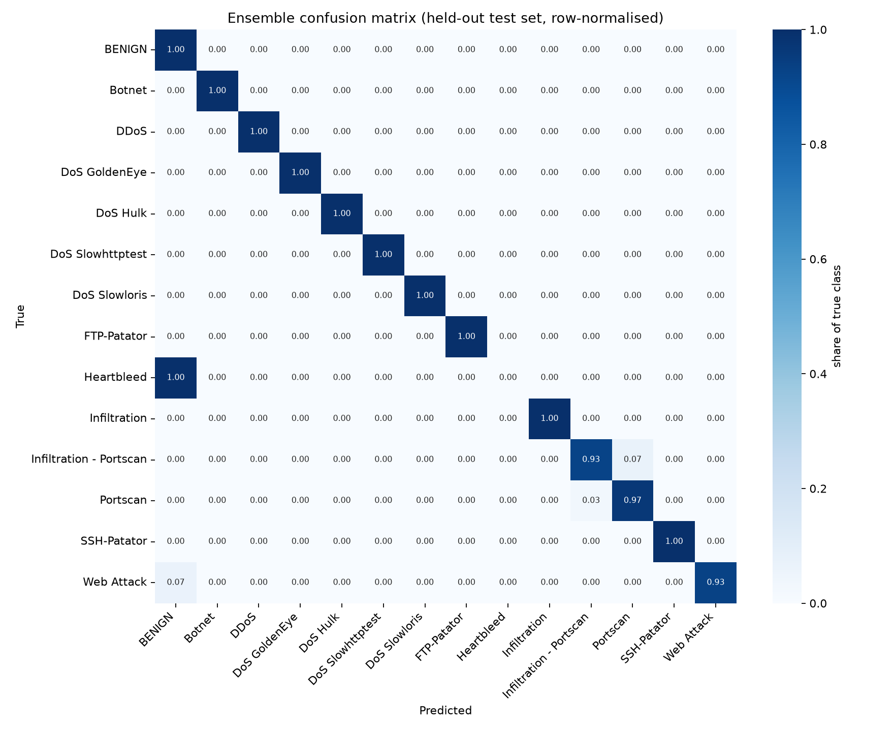

# Evaluation report

Held-out test set: **312,656 flows** (never seen during training or model selection).

| Model | Accuracy | Macro F1 (all classes) | Macro F1 (classes with 30+ test flows) | Detection rate | False positive rate |
|---|---|---|---|---|---|
| Ensemble (deployed, RF weight 0.00) | 0.9952 | 0.9185 | 0.9903 | 0.9999 | 0.0042% |
| Random Forest | 0.9951 | 0.9894 | 0.9896 | 0.9998 | 0.0021% |
| XGBoost | 0.9952 | 0.9185 | 0.9903 | 0.9999 | 0.0042% |

## Per-class results (ensemble)

| Class | Precision | Recall | F1 | Test flows |
|---|---|---|---|---|
| BENIGN | 1.000 | 1.000 | 1.000 | 237,315 |
| Botnet | 1.000 | 1.000 | 1.000 | 111 |
| DDoS | 1.000 | 1.000 | 1.000 | 14,272 |
| DoS GoldenEye | 0.998 | 1.000 | 0.999 | 1,135 |
| DoS Hulk | 1.000 | 1.000 | 1.000 | 23,770 |
| DoS Slowhttptest | 0.996 | 1.000 | 0.998 | 261 |
| DoS Slowloris | 1.000 | 1.000 | 1.000 | 579 |
| FTP-Patator | 1.000 | 1.000 | 1.000 | 596 |
| Heartbleed * | 0.000 | 0.000 | 0.000 | 1 |
| Infiltration * | 1.000 | 1.000 | 1.000 | 5 |
| Infiltration - Portscan | 0.927 | 0.928 | 0.927 | 10,293 |
| Portscan | 0.969 | 0.969 | 0.969 | 23,859 |
| SSH-Patator | 1.000 | 1.000 | 1.000 | 444 |
| Web Attack * | 1.000 | 0.933 | 0.966 | 15 |

\* Fewer than 30 test flows: treat these scores as indicative only. Macro F1 weights every class equally, so these small classes move it a lot.

## Speed (single process, this machine)

- One flow: 6.4 ms median, 7.0 ms p95
- Batch: 25,256 flows/second
- SHAP explanation: 11.2 ms median (on demand)

