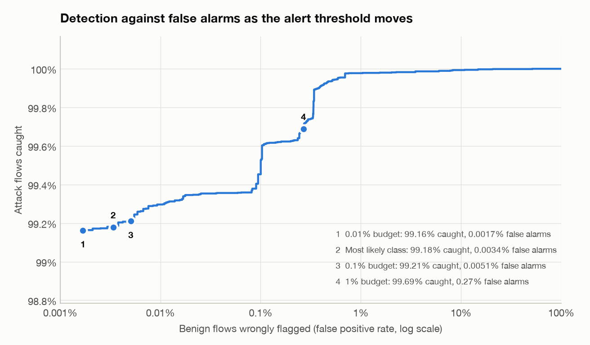
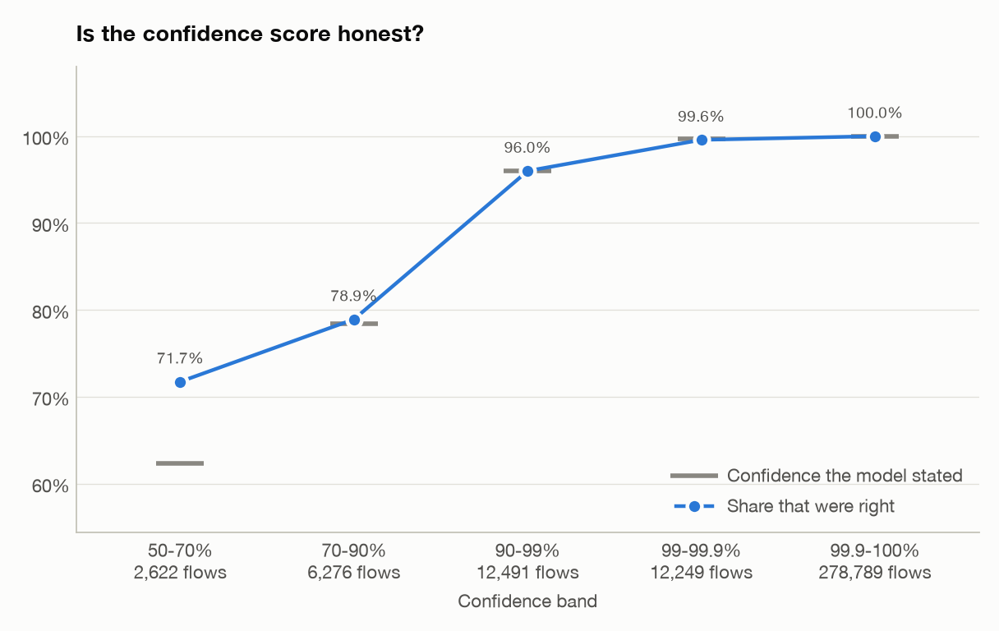
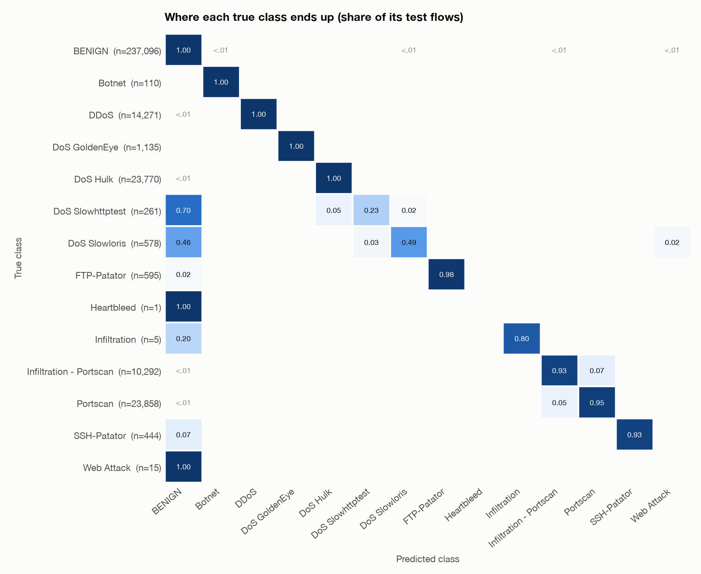

# Evaluation report

Held-out test set: **312,431 flows**, never seen during training or model selection. The split is time-ordered: on each day the model trained on the earliest 70% of each class and is tested here on the last 15%.

| Model | Accuracy | Macro F1 (all classes) | Macro F1 (classes with 30+ test flows) | Detection rate | False positive rate |
|---|---|---|---|---|---|
| Ensemble (deployed, RF weight 0.25) | 0.9916 | 0.7648 | 0.8925 | 0.9918 | 0.0034% |
| Random Forest | 0.9916 | 0.7705 | 0.8998 | 0.9915 | 0.0017% |
| XGBoost | 0.9916 | 0.7647 | 0.8924 | 0.9918 | 0.0038% |

Detection rate is the share of attack flows flagged as any attack. False positive rate is the share
of benign flows flagged as an attack.

95% intervals for the deployed model (bootstrap over test flows; they show sampling noise only,
not how the model would do on a different network):

| | Value | 95% interval |
|---|---|---|
| Accuracy | 99.16% | 99.12% to 99.19% |
| Macro F1 (30+ flows) | 0.8925 | 0.8851 to 0.8997 |
| Detection rate | 99.18% | 99.11% to 99.24% |
| False positive rate | 0.0034% | 0.0013% to 0.0059% |

## Per-class results (deployed model)

| Class | Precision | Recall | F1 | Test flows |
|---|---|---|---|---|
| BENIGN | 0.997 | 1.000 | 0.999 | 237,096 |
| Botnet | 0.991 | 1.000 | 0.995 | 110 |
| DDoS | 1.000 | 0.999 | 0.999 | 14,271 |
| DoS GoldenEye | 1.000 | 1.000 | 1.000 | 1,135 |
| DoS Hulk | 0.999 | 1.000 | 1.000 | 23,770 |
| DoS Slowhttptest | 0.762 | 0.234 | 0.358 | 261 |
| DoS Slowloris | 0.983 | 0.486 | 0.650 | 578 |
| FTP-Patator | 1.000 | 0.983 | 0.992 | 595 |
| Heartbleed * | 0.000 | 0.000 | 0.000 | 1 |
| Infiltration * | 1.000 | 0.800 | 0.889 | 5 |
| Infiltration - Portscan | 0.887 | 0.929 | 0.907 | 10,292 |
| Portscan | 0.969 | 0.945 | 0.957 | 23,858 |
| SSH-Patator | 1.000 | 0.926 | 0.961 | 444 |
| Web Attack * | 0.000 | 0.000 | 0.000 | 15 |

\* Fewer than 30 test flows: treat these scores as indicative only. Macro F1 weights every class equally, so these small classes move it a lot.

## Where it goes wrong

| True class | Predicted as | Flows | Share of the true class |
|---|---|---|---|
| Portscan | Infiltration - Portscan | 1,221 | 5.1% |
| Infiltration - Portscan | Portscan | 733 | 7.1% |
| DoS Slowloris | BENIGN | 264 | 45.7% |
| DoS Slowhttptest | BENIGN | 182 | 69.7% |
| Portscan | BENIGN | 86 | 0.4% |
| SSH-Patator | BENIGN | 33 | 7.4% |
| DDoS | BENIGN | 21 | 0.1% |
| DoS Slowloris | DoS Slowhttptest | 19 | 3.3% |

Most errors are between closely related classes. Scored more coarsely:

| Scoring | Accuracy | Macro F1 (30+ flows) |
|---|---|---|
| All 14 classes | 99.16% | 0.8925 |
| The two port-scan classes counted as one | 99.78% | 0.8953 |
| By attack family (Botnet, Brute force, Denial of service, Exploit, Infiltration, Scanning, Web attack) | 99.79% | 0.9931 |

## Choosing an alert threshold

Every flow gets an attack score, 1 - P(benign). Alerting on a score threshold instead of the most
likely class trades false alarms for detections. Thresholds below were set on the validation
split to hit a false-alarm budget, then measured on the test split.

| Setting | Score threshold | False positive rate (test) | Detection rate (test) | Least-detected class (30+ flows) |
|---|---|---|---|---|
| Model's own decision (most likely class) | n/a | 0.0034% | 99.18% | DoS Slowhttptest (30.3%) |
| Alert budget 1% of benign flows | 0.0338 | 0.2678% | 99.69% | DoS Slowhttptest (44.8%) |
| Alert budget 0.1% of benign flows | 0.3473 | 0.0051% | 99.21% | DoS Slowhttptest (31.0%) |
| Alert budget 0.01% of benign flows | 0.7549 | 0.0017% | 99.16% | DoS Slowhttptest (28.7%) |

## Is the confidence score honest?

A prediction made with 90% confidence should be right about 90% of the time.

| Confidence band | Test flows | Mean confidence | Actually correct |
|---|---|---|---|
| 0.0% to 50.0% | 4 | 46.6% | 25.0% |
| 50.0% to 70.0% | 2,622 | 62.4% | 71.7% |
| 70.0% to 90.0% | 6,276 | 78.4% | 78.9% |
| 90.0% to 99.0% | 12,491 | 96.0% | 96.0% |
| 99.0% to 99.9% | 12,249 | 99.7% | 99.6% |
| 99.9% to 100.0% | 278,789 | 100.0% | 100.0% |

Expected calibration error: 0.099%.

## Speed (single process, this machine)

- One flow: 6.8 ms median, 7.3 ms p95
- Batch: 25,134 flows/second
- SHAP explanation: 10.7 ms median (on demand)

## Confusion matrix

